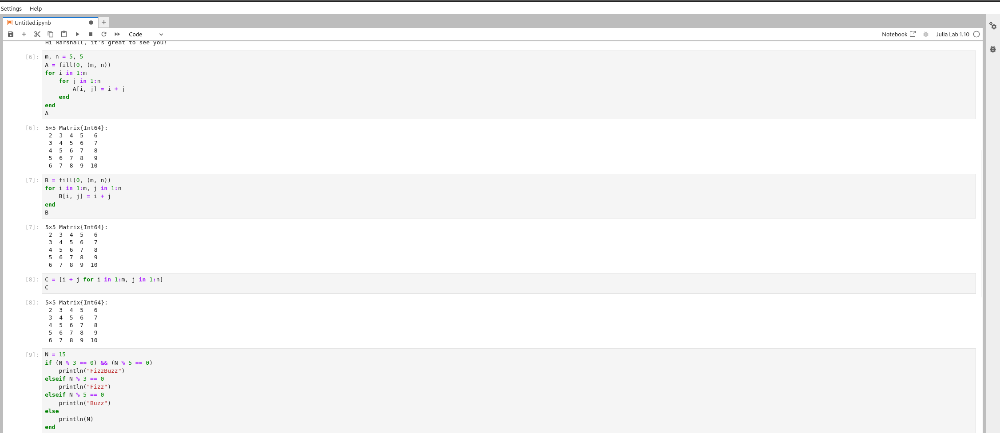
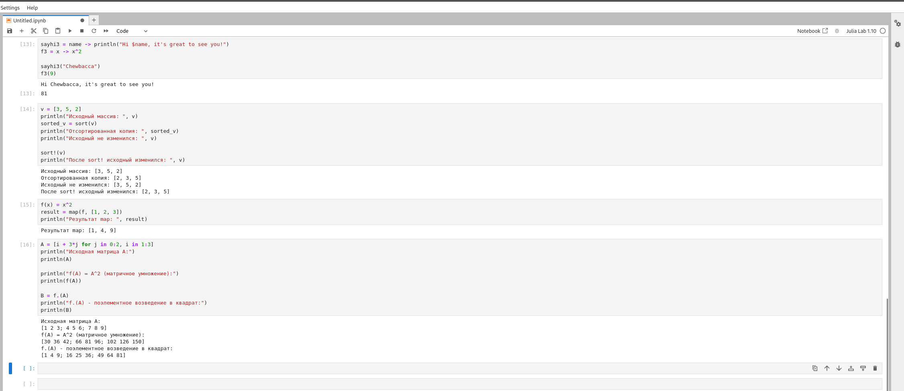
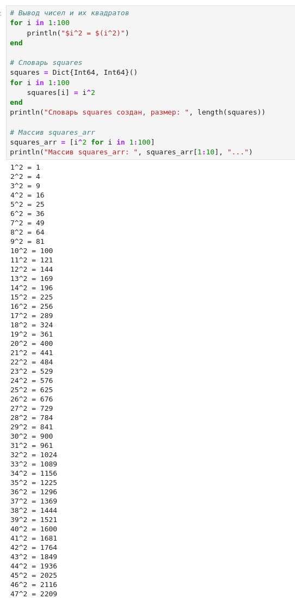
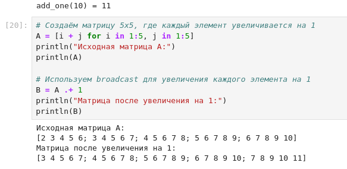
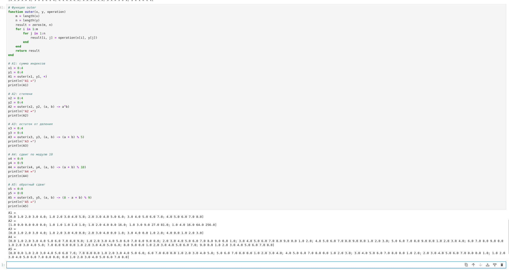

---
## Front matter
lang: ru-RU
title: Лабораторная работа №3
subtitle: Компьютерный практикум по статистическому анализу данных
author:
  - Лисенков Е.Р.
institute:
  - Российский университет дружбы народов, Москва, Россия

## i18n babel
babel-lang: russian
babel-otherlangs: english

## Formatting pdf
toc: false
toc-title: Содержание
slide_level: 2
aspectratio: 169
section-titles: true
theme: metropolis
header-includes:
 - \metroset{progressbar=frametitle,sectionpage=progressbar,numbering=fraction}
 - '\makeatletter'
 - '\beamer@ignorenonframefalse'
 - '\makeatother'
---

# Информация

## Докладчик

:::::::::::::: {.columns align=center}
::: {.column width="70%"}

  * Лисенков Егор Романович
  * студент НФИбд-02-23
  * Российский университет дружбы народов
  * [1132232881@rudn.ru](mailto:1132232881@rudn.ru)
  * <https://github.com/erlisenkov>

:::
::: {.column width="30%"}

ц

:::
::::::::::::::

# Вводная часть

## Актуальность
Циклы, условные выражения и функции составляют основу управляющих структур любого языка программирования, и их освоение в Julia необходимо для решения задач линейной алгебры и работы с матрицами.

## Объект и предмет исследования
Объектом выступают управляющие структуры языка Julia, а предметом — применение циклов, условных выражений, функций и функций высшего порядка для решения вычислительных задач.

## Цели и задачи
Целью работы является освоение циклов, условных выражений и способов определения функций, а задачами — воспроизведение примеров методических указаний и выполнение одиннадцати заданий самостоятельной работы.

## Материалы и методы
Работа выполнена в операционной системе Fedora с использованием языка Julia версии 1.10.3, интерактивной среды Jupyter Lab и системы контроля версий Git.

## Циклы while и for
Примеры циклов while и for над числами и строковыми массивами подтвердили эквивалентность подходов и выразительность цикла for при переборе коллекций.
{#fig:001 width=100%}

## Страница запуска Jupyter Lab
Работа выполнена в среде Jupyter Lab с выбором ядра Julia 1.10 из доступных ядер Python 3 и Julia.
{#fig:002 width=100%}

## Создание матриц и условное выражение FizzBuzz
Матрица с элементами, равными сумме индексов, построена тремя способами: вложенными циклами, комбинированным циклом и генератором, а условное выражение FizzBuzz воспроизведено для числа 15.
{#fig:003 width=100%}

## Анонимные функции, сортировка и функции высшего порядка
Соглашение о восклицательном знаке проверено сравнением sort и sort!, а различие матричной и поэлементной операций продемонстрировано функцией map и вызовами f(A) и f.(A).
{#fig:004 width=100%}

## Три способа определения функций и тернарный оператор
Функции определены через ключевые слова function и end, в одну строку и как анонимные, а эквивалентность тернарного оператора условному выражению подтверждена значением 10.
{#fig:005 width=100%}

## Задание 1: циклы, словарь и массив квадратов
Квадраты чисел от 1 до 100 получены тремя способами: выводом в цикле, накоплением в словаре размера 100 и формированием массива-генератора.
{#fig:006 width=100%}

## Задание 2: условный оператор и тернарный оператор
Для проверочного значения 7 обе формы ветвления вывели строку «нечётное», что подтвердило эквивалентность конструкции if-else и тернарного оператора.
{#fig:007 width=100%}

## Задание 3: функция add_one
Функция, добавляющая единицу к своему входу, определена через ключевые слова function и end и вернула значения 6 и 11 для контрольных вызовов.
{#fig:008 width=100%}

## Задание 4: поэлементное увеличение матрицы
Точечный синтаксис broadcast увеличил каждый элемент матрицы 5x5 на единицу без изменения её структуры.
{#fig:009 width=100%}

## Задание 5: куб матрицы и замена столбца
Куб заданной матрицы оказался нулевым вследствие нильпотентности, а замена третьего столбца на сумму второго и третьего дала ожидаемую матрицу.
{#fig:010 width=100%}

## Задание 6: матрица B и произведение C = B^T * B
Матрица 15x3 с постоянными столбцами заполнена в цикле, и произведение с транспонированной матрицей дало матрицу с элементами 1500 и минус 1500.
{#fig:011 width=100%}

## Задание 7: построение матриц Z1-Z4
Четыре матрицы 6x6 с заданными закономерностями расположения единиц построены из нулевой матрицы вложенными циклами с условиями на чётность сумм индексов.
{#fig:012 width=100%}

## Задание 8: функция outer и матрицы A1-A5
Реализована собственная функция outer, аналогичная функции языка R, и с её помощью построены пять матриц заданной структуры, включая циклические и степенные.
{#fig:013 width=100%}

## Задание 9: решение системы линейных уравнений
Система пяти уравнений с тёплицевой матрицей коэффициентов решена оператором обратного слэша с решением [-2, 3, 5, 2, -4], подтверждённым контрольной подстановкой.
{#fig:014 width=100%}

## Задание 10: статистический анализ случайной матрицы
Для случайной матрицы 6x10 подсчитаны числа элементов выше порога в строках, найдены строки с ровно двумя вхождениями заданного значения и проверены пары столбцов с суммой выше порога.
{#fig:015 width=100%}

## Задание 11: вычисление двойных сумм
Двойные суммы с разделимым и неразделимым знаменателем вычислены генераторами с двумя переменными перебора и равны 639215.28 и 89912.02.
{#fig:016 width=100%}

## Вывод
В ходе лабораторной работы освоены управляющие структуры языка Julia: циклы while и for, условные выражения с ключевыми словами и тернарные операторы, три способа определения функций и функции высшего порядка с точечным синтаксисом. Выполнены все одиннадцать заданий самостоятельной работы, включая матричные операции, решение системы линейных уравнений обобщаемым методом и вычисление двойных сумм, что подтвердило эффективность и обобщаемость применённых подходов. Результаты зафиксированы в системе контроля версий Git.

