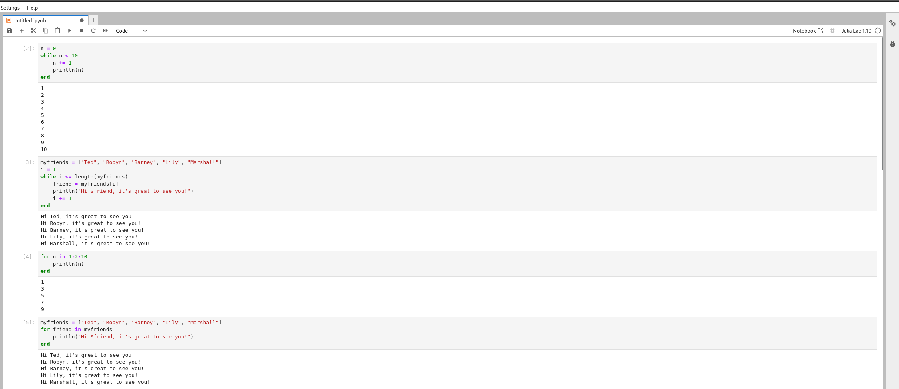
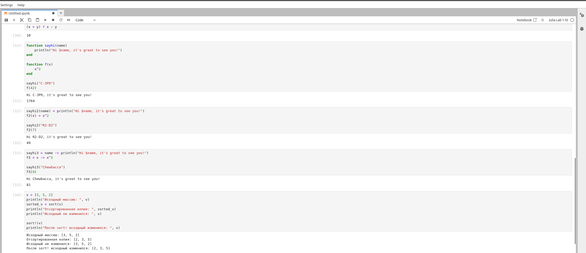
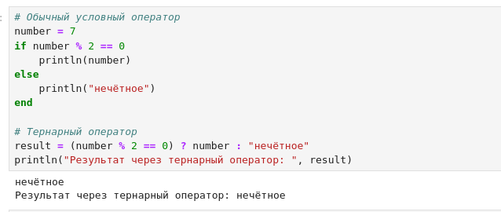
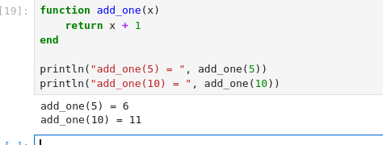
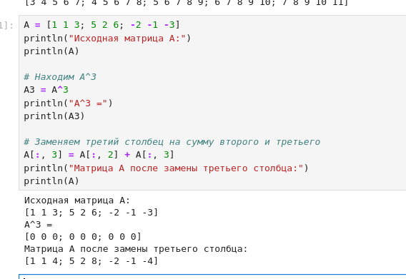
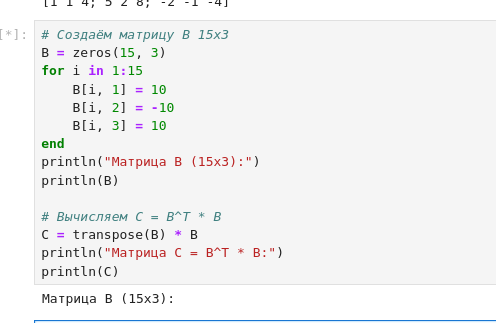
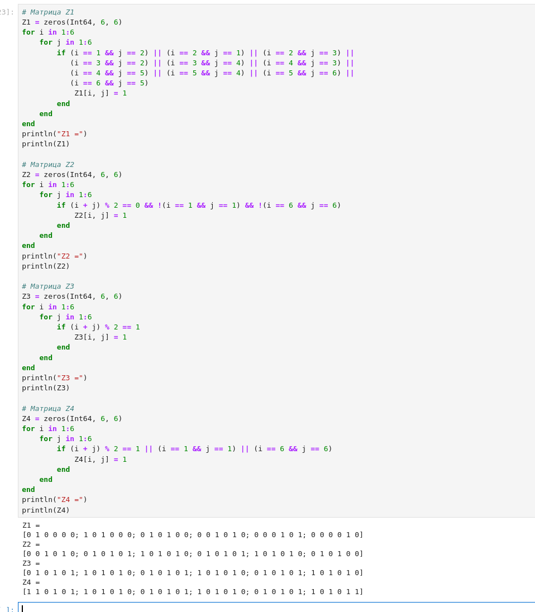
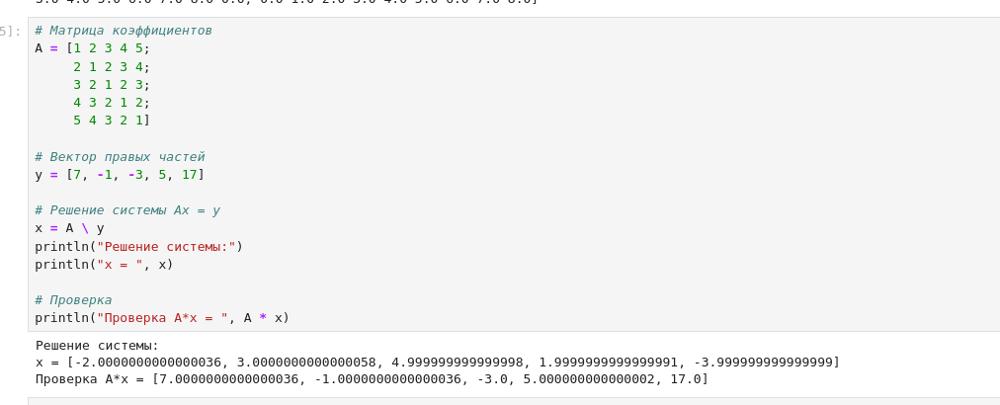
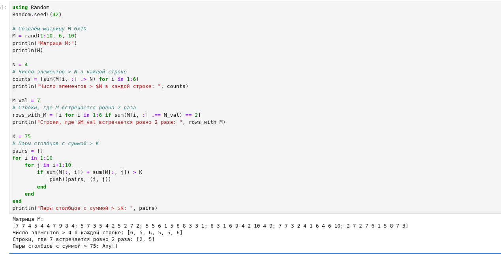
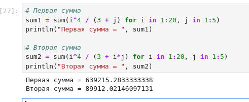

---
## Front matter
title: "Отчёт по лабораторной работе №3 2026"
subtitle: "Компьютерный практикум по статистическому анализу данных"
author: "Лисенков Егор Романович"

## Generic otions
lang: ru-RU
toc-title: "Содержание"

## Bibliography
bibliography: bib/cite.bib
csl: pandoc/csl/gost-r-7-0-5-2008-numeric.csl

## Pdf output format
toc: true # Table of contents
toc-depth: 2
lof: true # List of figures
lot: true # List of tables
fontsize: 12pt
linestretch: 1.5
papersize: a4
documentclass: scrreprt
## I18n polyglossia
polyglossia-lang:
  name: russian
  options:
	- spelling=modern
	- babelshorthands=true
polyglossia-otherlangs:
  name: english
## I18n babel
babel-lang: russian
babel-otherlangs: english
## Fonts
mainfont: PT Serif
romanfont: PT Serif
sansfont: PT Sans
monofont: PT Mono
mainfontoptions: Ligatures=TeX
romanfontoptions: Ligatures=TeX
sansfontoptions: Ligatures=TeX,Scale=MatchLowercase
monofontoptions: Scale=MatchLowercase,Scale=0.9
## Biblatex
biblatex: true
biblio-style: "gost-numeric"
biblatexoptions:
  - parentracker=true
  - backend=biber
  - hyperref=auto
  - language=auto
  - autolang=other*
  - citestyle=gost-numeric
## Pandoc-crossref LaTeX customization
figureTitle: "Рис."
tableTitle: "Таблица"
listingTitle: "Листинг"
lofTitle: "Список иллюстраций"
lotTitle: "Список таблиц"
lolTitle: "Листинги"
## Misc options
indent: true
header-includes:
  - \usepackage{indentfirst}
  - \usepackage{float} # keep figures where there are in the text
  - \floatplacement{figure}{H} # keep figures where there are in the text
---

# Выполнение лабораторной работы

# Цель работы

Освоение применения циклов, функций и сторонних для Julia пакетов для решения задач линейной алгебры и работы с матрицами. Изучение управляющих структур языка Julia: циклов while и for, условных выражений с ключевыми словами и тернарных операторов, различных способов определения функций, функций высшего порядка map и broadcast, а также соглашения об именовании функций, изменяющих свои аргументы.

# Задание

Используя Jupyter Lab, повторить примеры раздела 3.2 методических указаний: демонстрацию циклов while и for, создание двумерных массивов с помощью циклов и генераторов, условных выражений с ключевыми словами и тернарных операторов, определение функций тремя способами, сравнение функций sort и sort!, применение функций высшего порядка map и broadcast с точечным синтаксисом. Выполнить задания для самостоятельной работы раздела 3.4: вычисление квадратов чисел циклами, словарём и генератором; условный оператор и тернарный оператор для проверки чётности; функцию add_one; поэлементное увеличение матрицы через broadcast; операции над заданной матрицей A включая куб матрицы и замену столбца; построение матрицы B и произведения C = B^T * B; построение матриц Z1-Z4 по закономерностям; собственную функцию outer и матрицы A1-A5; решение системы пяти линейных уравнений; статистический анализ случайной матрицы M; вычисление двойных сумм. Оформить отчёт с пояснениями, скриншотами и листингами.

# Конкретные задачи

Создать каталог labs/lab03 в репозитории курса и запустить интерактивную среду Jupyter Lab с ядром Julia 1.10. Создать рабочий блокнот и воспроизвести в нём примеры раздела 3.2: циклы while и for над числами и строковыми массивами, три способа создания матрицы с элементами, равными сумме индексов, условное выражение FizzBuzz и тернарный оператор, определение функций через function/end, в одну строку и как анонимных, сравнение сортировки с копией и на месте, применение map и broadcast к векторам и матрицам. Выполнить одиннадцать заданий самостоятельной работы, охватывающих циклы, словари, условные операторы, функции, матричные операции, решение систем линейных уравнений и вычисление двойных сумм. Зафиксировать результаты в системе контроля версий Git.

# Теоретическое введение

Для перебора индексируемых элементов структур данных в Julia традиционно используются циклы while и for. Цикл while выполняет тело до тех пор, пока истинно условие; цикл for перебирает элементы диапазона или коллекции. Оба цикла могут использоваться для формирования массивов и работы со строковыми элементами, подставляя значения в выводимые конструкции. Существует также комбинированная форма записи нескольких переменных цикла в одном заголовке и генераторы массивов, позволяющие заменить явные циклы одним выражением в квадратных скобках.

Условные выражения реализуются конструкцией if, elseif, else, а также тернарным оператором вида a ? b : c, эквивалентным условному выражению с ключевыми словами. Логические операции комбинируются с помощью операторов && и ||, а проверка делимости выполняется через операцию взятия остатка от деления. Тернарный оператор возвращает значение, которое может быть сохранено в переменной и использовано далее, что делает его удобной компактной формой ветвления.

Julia предоставляет несколько способов определения функций: через ключевые слова function и end, в виде однострочной записи вида имя(аргументы) = выражение, а также как анонимные функции с использованием стрелочной нотации. По соглашению функции, сопровождаемые восклицательным знаком, изменяют свои аргументы на месте, тогда как функции без восклицательного знака возвращают новый объект, оставляя исходный без изменений; классическим примером является пара sort и sort!. Функции могут передаваться как аргументы других функций, что открывает путь к функциям высшего порядка.

Под функцией высшего порядка понимается функция, принимающая другие функции в качестве аргументов или возвращающая функцию как результат. В Julia такими функциями являются map, применяющая переданную функцию к каждому элементу структуры, и broadcast, являющаяся обобщением map и приводящая все объекты к общему измерению. Точечный синтаксис записи f.(A) позволяет применять функцию поэлементно, тогда как вызов f(A) без точки выполняет матричную операцию, если она определена для массива целиком. Для решения систем линейных уравнений применяется оператор обратного слэша, реализующий численно устойчивые методы линейной алгебры и легко обобщаемый на системы большего размера.

# Выполнение лабораторной работы

Выполнение работы началось с воспроизведения примеров использования циклов. В ячейке с циклом while счётчик n инициализирован нулём и на каждой итерации увеличивается на единицу с выводом значения, в результате на экран последовательно напечатаны числа от 1 до 10. Второй пример демонстрирует цикл while над строковым массивом myfriends: переменная i пробегает индексы массива, имя друга подставляется в строку приветствия через интерполяцию, и выводится пять приветствий. Те же результаты получены с помощью цикла for: конструкция for n in 1:2:10 с шагом 2 вывела нечётные числа 1, 3, 5, 7, 9, а цикл for friend in myfriends перебрал элементы массива напрямую без использования индексов, что подтверждает эквивалентность подходов и большую выразительность цикла for при переборе коллекций (рис. [-@fig:001]).

{#fig:001 width=70%}

Лабораторная работа выполнялась в интерактивной среде Jupyter Lab, страница запуска которой зафиксирована на снимке. В разделе Notebook представлены два доступных ядра: Python 3 (ipykernel) и Julia 1.10; для выполнения работы использовалось ядро Julia 1.10. Раздел Console предоставляет те же ядра для интерактивной консоли, а раздел Other содержит средства создания терминала, текстовых и Markdown-файлов, файлов Julia и Python. На левой панели видна структура репозитория курса с каталогами project, report и presentation, что подтверждает выполнение работы в рамках организованного рабочего пространства курса (рис. [-@fig:002]).

{#fig:002 width=70%}

Далее были воспроизведены три способа создания двумерного массива, в котором значение каждой записи является суммой индексов строки и столбца. При размерах m, n = 5, 5 массив A инициализирован нулями через fill(0, (m, n)) и заполнен во вложенных циклах for i in 1:m и for j in 1:n присваиванием A[i, j] = i + j; результатом стала матрица 5x5 с элементами от 2 до 10. Вторая реализация использует комбинированный цикл for i in 1:m, j in 1:n для заполнения массива B, третья — генератор массива C = [i + j for i in 1:m, j in 1:n]; все три способа дали идентичный результат, что демонстрирует постепенное упрощение синтаксиса от явных вложенных циклов к генератору. Затем воспроизведено условное выражение FizzBuzz: для N = 15 проверяется делимость на 3 и 5 через операцию остатка и логическое И, и поскольку 15 делится на оба числа, выполняется ветвь с выводом строки FizzBuzz (рис. [-@fig:003]).

{#fig:003 width=70%}

Продолжением работы стало изучение анонимных функций и функций высшего порядка. Анонимные функции sayhi3 = name -> println(...) и f3 = x -> x^2 вызваны с аргументами Chewbacca и 9, результатом второго вызова стало значение 81. Сравнение sort(v) и sort!(v) на массиве v = [3, 5, 2] подтвердило соглашение о восклицательном знаке: sort вернула отсортированную копию [2, 3, 5], оставив исходный массив неизменным, тогда как sort! отсортировала сам исходный массив. Функция высшего порядка map применена к вектору [1, 2, 3] с функцией возведения в квадрат и дала результат [1, 4, 9]. Для матрицы A = [i + 3*j for j in 0:2, i in 1:3], равной [1 2 3; 4 5 6; 7 8 9], вызов f(A) без точки выполнил матричное умножение A на A с результатом [30 36 42; 66 81 96; 102 126 150], тогда как точечный вызов f.(A) посредством broadcast возвёл в квадрат каждый элемент и дал матрицу [1 4 9; 16 25 36; 49 64 81], что наглядно иллюстрирует различие между матричной операцией и поэлементным применением (рис. [-@fig:004]).

{#fig:004 width=70%}

Завершающим этапом воспроизведения примеров раздела 3.2 стала демонстрация всех трёх способов определения функций и тернарного оператора. Функции sayhi и f определены через ключевые слова function и end: вызов sayhi("C-3PO") вывел приветствие, а f(42) дало 1764. Однострочные определения sayhi2(name) = println(...) и f2(x) = x^2 дали те же результаты: вызов f2(7) вернул 49. Анонимные определения sayhi3 и f3 через стрелочную нотацию завершились результатом 81 для f3(9). Тернарный оператор (x > y) ? x : y при x = 5 и y = 10 вернул значение 10, что эквивалентно работе условного выражения с ключевыми словами. Повторное сравнение sort(v) и sort!(v) на массиве [3, 5, 2] окончательно закрепило понимание соглашения о функциях, изменяющих свои аргументы: исходный массив изменился только после применения sort! (рис. [-@fig:005]).

{#fig:005 width=70%}

Первым заданием самостоятельной работы стала демонстрация циклов при вычислении квадратов целых чисел. В цикле for i in 1:100 на экран последовательно выводились числа и их квадраты в формате строки с интерполяцией, при этом в выводе зафиксированы строки от 1 в квадрате равна 1 до 100 в квадрате равна 10000. Затем в цикле был заполнен словарь squares типа Dict с целочисленными ключами и значениями-квадратами: после заполнения функция length(squares) подтвердила размер словаря, равный 100. Третья часть задания выполнила ту же задачу через генератор массива: squares_arr = [i^2 for i in 1:100], и вывод первых десяти элементов продемонстрировал корректность построения массива квадратов. Таким образом, одна и та же вычислительная задача решена тремя способами: с выводом в цикле, с накоплением в словаре и с формированием массива-генератора (рис. [-@fig:006]).

{#fig:006 width=70%}

Во втором задании был написан условный оператор, печатающий число при его чётности и строку «нечётное» в противном случае. Для проверочного значения number = 7 операция взятия остатка number % 2 == 0 дала false, поэтому ветвь else вывела строку «нечётное». Далее код был переписан с использованием тернарного оператора: result = (number % 2 == 0) ? number : "нечётное", и вывод строки «Результат через тернарный оператор: нечётное» подтвердил полную эквивалентность двух форм записи условного выражения. Задание наглядно продемонстрировало, что тернарный оператор является компактной формой конструкции if-else, возвращающей значение, которое можно сохранить в переменной и использовать далее (рис. [-@fig:007]).

{#fig:007 width=70%}

Третье задание посвящено определению простейшей функции add_one, которая добавляет единицу к своему входу. Функция определена через ключевые слова function и end с явным оператором return x + 1. Контрольные вызовы add_one(5) и add_one(10) дали результаты 6 и 11 соответственно, что выведено на экран с поясняющими строками. Задание закрепило базовый синтаксис определения функций с позиционным аргументом и возвратом значения, который далее используется в заданиях на функции высшего порядка (рис. [-@fig:008]).

{#fig:008 width=70%}

В четвёртом задании с помощью генератора создана матрица A размером 5x5, каждый элемент которой равен сумме индексов i + j и потому увеличивается на единицу при движении по строке и столбцу: элементы изменяются от 2 до 10. Затем с использованием точечного синтаксиса broadcast выполнена операция B = A .+ 1, увеличившая каждый элемент матрицы на единицу без изменения её структуры: результирующая матрица содержит элементы от 3 до 11, что подтверждено выводом обеих матриц. Задание продемонстрировало применение поэлементных операций к двумерным массивам: точка перед оператором сложения гарантирует поэлементное применение, в отличие от матричных операций без точки (рис. [-@fig:009]).

{#fig:009 width=70%}

Пятое задание выполнено с матрицей A вида [1 1 3; 5 2 6; -2 -1 -3]. Вычисление куба матрицы через A^3 дало нулевую матрицу 3x3, что является нетривиальным наблюдением: исходная матрица нильпотентна, и её третья степень обращается в ноль, тогда как первая и вторая степени ненулевые. После этого третий столбец матрицы был заменён на сумму второго и третьего столбцов присваиванием среза A[:, 3] = A[:, 2] + A[:, 3], в результате чего матрица приняла вид [1 1 4; 5 2 8; -2 -1 -4], что подтверждено итоговым выводом. Задание закрепило навыки матричных степеней и модификации столбцов через срезы с поэлементным сложением (рис. [-@fig:010]).

{#fig:010 width=70%}

Шестое задание самостоятельной работы посвящено построению прямоугольной матрицы и вычислению произведения с транспонированной матрицей. Матрица B размера 15x3 создана инициализацией нулями через zeros(15, 3) с последующим заполнением в цикле for i in 1:15: первый столбец получил значение 10, второй — минус 10, третий — 10, то есть каждая строка имеет вид [10, -10, 10]. Затем вычислена матрица C = transpose(B) * B размера 3x3; поскольку столбцы матрицы B постоянны, элементы C равны попарным произведениям значений столбцов, умноженным на число строк: диагональные элементы равны 1500, а внедиагональные чередуются между минус 1500 и 1500, что и зафиксировано выводом. Задание закрепило навыки программного заполнения матриц по правилу и выполнения матричных произведений с транспонированием (рис. [-@fig:011]).

{#fig:011 width=70%}

Седьмое задание выполнено построением четырёх матриц Z1, Z2, Z3 и Z4 размерности 6x6 из нулевой матрицы с помощью вложенных циклов и условий на индексы, отражающих закономерности расположения единиц. Матрица Z1 получена установкой единиц на соседних боковых диагоналях: единица ставится в позицию [i, j], если индексы отличаются на единицу, что дало трёхдиагональную структуру с нулевой главной диагональю. Матрица Z2 заполнена единицами в позициях с чётной суммой индексов, за исключением угловых позиций [1, 1] и [6, 6], которые принудительно обнулены условием отрицания. Матрица Z3 представляет собой шахматный узор с единицами в позициях с нечётной суммой индексов. Матрица Z4 совпадает с Z3, но дополнена единицами в угловых позициях [1, 1] и [6, 6] через дизъюнкцию условий. Все четыре выведенные матрицы полностью совпадают с заданными в методических указаниях образцами, что подтверждает корректность выбранных закономерностей (рис. [-@fig:012]).

{#fig:012 width=70%}

В восьмом задании реализована собственная функция outer(x, y, operation), аналогичная одноимённой функции языка R: она принимает два вектора и бинарную операцию, создаёт результирующую матрицу размера m на n и заполняет её во вложенных циклах значениями operation(x[i], y[j]), что делает решение легко обобщаемым на матрицы большей размерности. С помощью этой функции построены пять матриц заданной структуры: A1 получена операцией сложения на диапазонах 0:4 и содержит суммы индексов; A2 построена анонимной операцией возведения в степень a^b и содержит строки степеней от 0 до 256; A3 получена операцией остатка от деления суммы индексов на 5; A4 построена на диапазонах 0:9 операцией сдвига по модулю 10 и представляет собой циклическую матрицу размера 10x10; A5 построена на диапазонах 0:8 операцией обратного сдвига (8 - a + b) по модулю 9 и дала матрицу 9x9 с убывающими циклическими строками. Все пять выведенных матриц совпали с заданными образцами (рис. [-@fig:013]).

{#fig:013 width=70%}

Девятое задание выполнено решением системы пяти линейных уравнений с пятью неизвестными через соответствующее матричное уравнение Ax = y. Матрица коэффициентов A имеет особый симметричный вид: элемент в позиции [i, j] равен модулю разности индексов плюс единица, то есть каждая строка является сдвигом предыдущей, что относится к классу тёплицевых матриц. Вектор правых частей задан как y = [7, -1, -3, 5, 17]. Решение получено применением оператора обратного слэша x = A \ y, который использует численно устойчивые методы линейной алгебры и легко обобщается на системы большего размера с той же структурой матрицы. Вычисленный вектор решения равен x = [-2.0, 3.0, 5.0, 2.0, -4.0] с отклонениями на уровне машинной точности (порядка 10 в минус 14 степени), а контрольная подстановка A * x воспроизвела вектор правых частей [7, -1, -3, 5, 17], что подтверждает корректность решения (рис. [-@fig:014]).

{#fig:014 width=70%}

Десятое задание выполнено на случайной матрице M размера 6x10 с элементами из совокупности от 1 до 10, сгенерированной с фиксированным зерном Random.seed!(42) для воспроизводимости; матрица выведена на экран. Для порога N = 4 с помощью генератора и поэлементного сравнения подсчитано число элементов, больших N, в каждой строке: получен вектор [6, 5, 6, 5, 5, 6]. Затем определены строки, в которых значение M = 7 встречается ровно два раза: такими оказались строки 2 и 5. Наконец, двойным циклом по парам столбцов с условием на сумму элементов искались пары столбцов с суммой больше K = 75; результат оказался пустым списком, что согласуется с оценкой: максимальная сумма элементов одного столбца матрицы не превышает 36, поэтому сумма любой пары столбцов не превосходит 72 и порог 75 недостижим для данного заполнения. Задание продемонстрировало приёмы строчной и столбцовой агрегации случайных матриц (рис. [-@fig:015]).

{#fig:015 width=70%}

Завершающим, одиннадцатым заданием самостоятельной работы стало вычисление двойных сумм с помощью генераторов с двумя переменными перебора. Первая сумма по i от 1 до 20 и j от 1 до 5 выражения i^4 / (3 + j) вычислена функцией sum с вложенным генератором и равна 639215.2833333338; поскольку слагаемое распадается в произведение функции от i и функции от j, это значение равно произведению суммы четвёртых степеней на сумму обратных величин (3 + j), что служит независимой проверкой результата. Вторая сумма с знаменателем (3 + i*j), в котором переменные неразделимы, вычислена тем же приёмом и равна 89912.02146097131. Задание закрепило навык вычисления кратных сумм встроенными средствами Julia без явного написания вложенных циклов и завершило цикл самостоятельных заданий (рис. [-@fig:016]).

{#fig:016 width=70%}

# Результаты

В ходе выполнения лабораторной работы в интерактивной среде Jupyter Lab воспроизведены все примеры раздела 3.2 методических указаний: циклы while и for над числами и строковыми массивами, три способа создания матрицы с элементами, равными сумме индексов (вложенные циклы, комбинированный цикл и генератор), условное выражение FizzBuzz и тернарный оператор, три способа определения функций, сравнение sort и sort!, функции высшего порядка map и broadcast с демонстрацией различия матричной и поэлементной операций на примере f(A) и f.(A).

Выполнены все одиннадцать заданий самостоятельной работы раздела 3.4: квадраты чисел от 1 до 100 получены циклом с выводом, словарём размера 100 и массивом-генератором; условный оператор и тернарный оператор для числа 7 дали строку «нечётное»; функция add_one вернула 6 и 11 для входов 5 и 10; матрица 5x5 увеличена на единицу через broadcast; куб матрицы A = [1 1 3; 5 2 6; -2 -1 -3] оказался нулевым, а замена третьего столбца дала матрицу [1 1 4; 5 2 8; -2 -1 -4]; произведение C = transpose(B) * B для матрицы B 15x3 дало матрицу с элементами 1500 и минус 1500; матрицы Z1-Z4 совпали с образцами; функция outer построила матрицы A1-A5 заданной структуры; система пяти линейных уравнений решена оператором обратного слэша с решением [-2, 3, 5, 2, -4] и подтверждена подстановкой; для случайной матрицы M получены вектор счётчиков [6, 5, 6, 5, 5, 6], строки [2, 5] и пустой список пар столбцов; двойные суммы равны 639215.2833333338 и 89912.02146097131. Рабочий блокнот сохранён, зафиксирован в системе контроля версий Git и отправлен в удалённый репозиторий.

# Вывод

В результате выполнения лабораторной работы освоены управляющие структуры языка Julia: циклы while и for, условные выражения с ключевыми словами и тернарные операторы, различные способы определения функций. Практически подтверждена эквивалентность циклических конструкций и генераторов массивов, а также компактность тернарного оператора как формы ветвления, возвращающей значение. Сравнение пар sort и sort!, f(A) и f.(A) закрепило понимание соглашения о восклицательном знаке и различия между матричными и поэлементными операциями, определяемого точечным синтаксисом broadcast.

Выполнение самостоятельных заданий показало эффективность функций высшего порядка и обобщаемых решений: собственная функция outer воспроизводит функциональность одноимённой функции языка R и легко расширяется на матрицы большей размерности, а оператор обратного слэша решает системы линейных уравнений с тёплицевой матрицей без ручного вывода формул, что удовлетворяет требованию обобщаемости методов. Наблюдение нильпотентности матрицы и анализ пустого результата поиска пар столбцов продемонстрировали важность содержательной интерпретации численных результатов, а не только их формального получения.

Работа в Jupyter Lab позволила объединить исполняемый код, пояснения и результаты вычислений в едином документе, а фиксация в Git обеспечила воспроизводимость и сохраняемость хода выполнения. Лабораторная работа выполнена полностью в соответствии с требованиями методического пособия: примеры раздела 3.2 воспроизведены, все одиннадцать заданий раздела 3.4 выполнены, отчёт оформлен с пояснениями, скриншотами и листингами программ, выводы согласованы с заданием работы.

