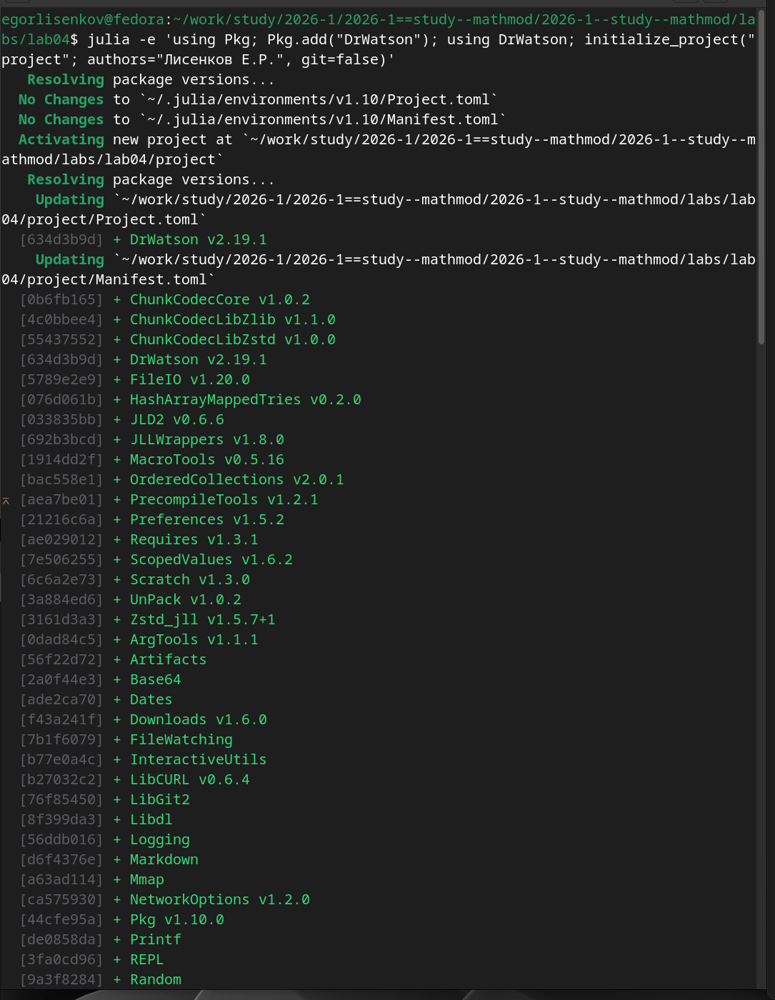
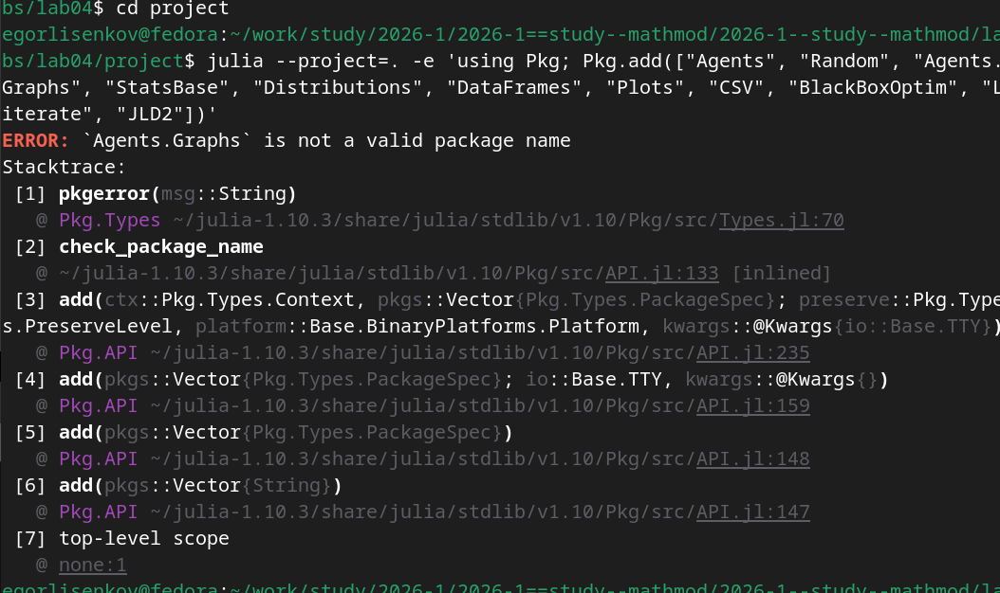
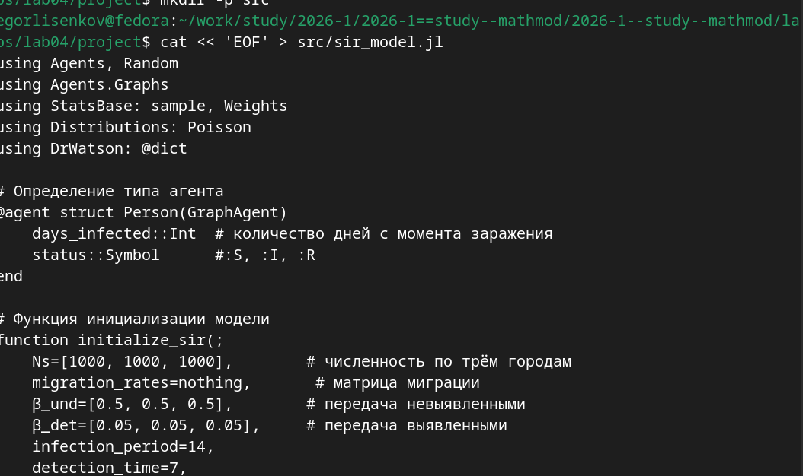
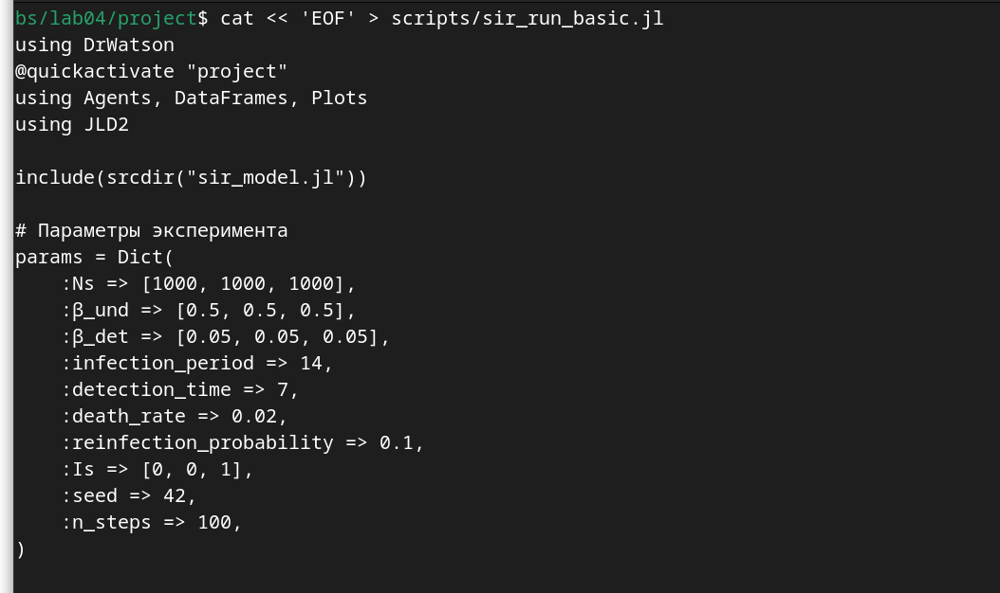
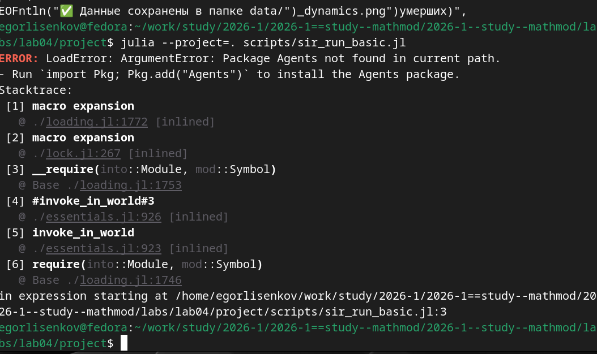

---
## Front matter
lang: ru-RU
title: Лабораторная работа №4
subtitle: Компьютерный практикум по статистическому анализу данных
author:
  - Лисенков Е.Р.
institute:
  - Российский университет дружбы народов, Москва, Россия

## i18n babel
babel-lang: russian
babel-otherlangs: english

## Formatting pdf
toc: false
toc-title: Содержание
slide_level: 2
aspectratio: 169
section-titles: true
theme: metropolis
header-includes:
 - \metroset{progressbar=frametitle,sectionpage=progressbar,numbering=fraction}
 - '\makeatletter'
 - '\beamer@ignorenonframefalse'
 - '\makeatother'
---

# Информация

## Докладчик

:::::::::::::: {.columns align=center}
::: {.column width="70%"}

  * Лисенков Егор Романович
  * студент НФИбд-02-23
  * Российский университет дружбы народов
  * [1132232881@rudn.ru](mailto:1132232881@rudn.ru)
  * <https://github.com/erlisenkov>

:::
::: {.column width="30%"}

ц

:::
::::::::::::::

# Вводная часть

## Актуальность
Операции линейной алгебры составляют основу численных методов и анализа данных, а специализированные пакеты Julia позволяют выполнять их эффективно и в компактной форме.

## Объект и предмет исследования
Объектом выступают объекты линейной алгебры в языке Julia, а предметом — операции над матрицами и векторами, факторизации и решение систем линейных уравнений средствами пакетов LinearAlgebra и Statistics.

## Цели и задачи
Целью работы является изучение возможностей специализированных пакетов Julia для операций над объектами линейной алгебры, а задачами — воспроизведение примеров методических указаний и выполнение заданий самостоятельной работы.

## Материалы и методы
Работа выполнена в операционной системе Fedora с использованием языка Julia версии 1.10.3, среды Jupyter Lab, пакетов LinearAlgebra и Statistics и системы контроля версий Git.

## Поэлементные операции пакета Statistics
Для случайной матрицы 4x3 вычислены суммы всех элементов и по столбцам, а также средние значения, и подготовлены ячейки для остальных примеров раздела.
{#fig:001 width=100%}

## Операции пакета LinearAlgebra и нормы
Для случайной матрицы 4x4 получены транспонирование, след, ранг, определитель и обратная матрица, а для векторов вычислены нормы, расстояние, угол, операторная норма матрицы и поворот на 180 градусов.
{#fig:002 width=100%}

## Матричное умножение, факторизации и произведение векторов
Вычислены произведение случайных матриц, единичная матрица и скалярное произведение, решена система уравнений оператором обратного слэша с LU- и QR-факторизациями и спектральным разложением, получено точное рациональное решение и найдены скалярное и внешнее произведения векторов.
{#fig:003 width=100%}

## Диагонализация, степени и корни матриц
Матрица приведена к диагональному виду, вычислены десятая степень и квадратный и кубический корни с обработкой отрицательных собственных значений через cbrt и комплексную область с проверкой обратной подстановкой, а также получены собственные значения симметричной матрицы пятого порядка и нижнетреугольная матрица.
{#fig:004 width=100%}

## Проверка продуктивности матриц
Реализована функция проверки продуктивности по критерию неотрицательности обратной матрицы и спектральному критерию, и обе тестовые матрицы признаны продуктивными по обоим критериям.
{#fig:005 width=100%}

## Вывод
В ходе лабораторной работы освоены возможности пакетов LinearAlgebra и Statistics для операций над объектами линейной алгебры: поэлементные операции, транспонирование, след, ранг, определитель, нормы, факторизации и спектральное разложение. Выполнены задания самостоятельной работы, включая вычисление корней матриц с обработкой отрицательных собственных значений и проверку продуктивности матриц по двум согласованным критериям. Результаты зафиксированы в системе контроля версий Git.
