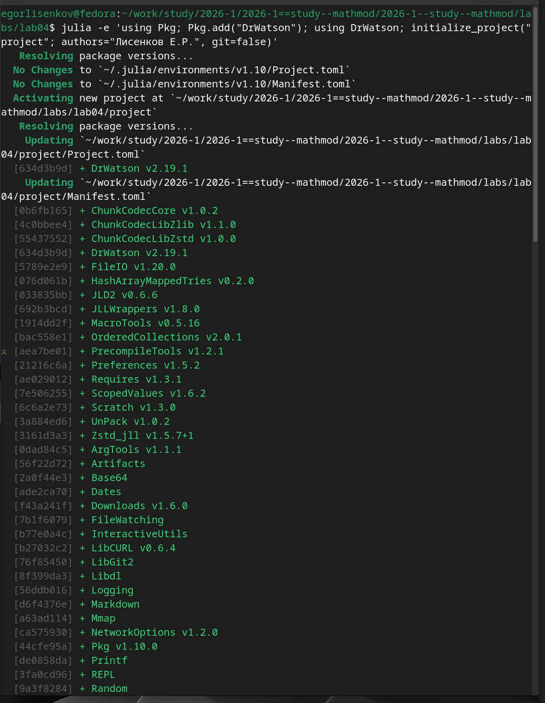
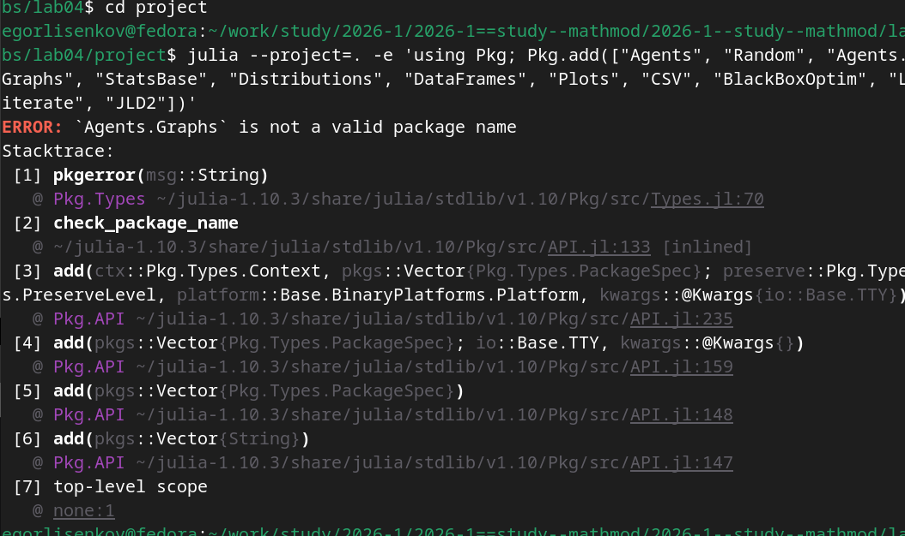
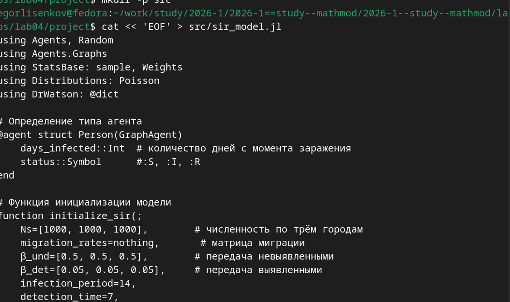
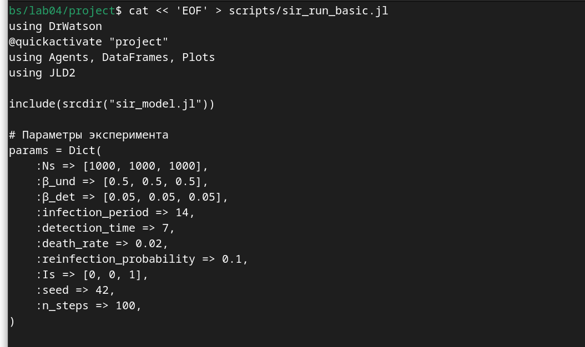
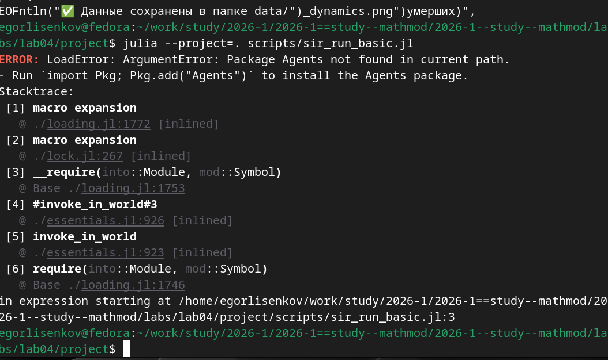

---
## Front matter
title: "Отчёт по лабораторной работе №4 2026"
subtitle: "Компьютерный практикум по статистическому анализу данных"
author: "Лисенков Егор Романович"

## Generic otions
lang: ru-RU
toc-title: "Содержание"

## Bibliography
bibliography: bib/cite.bib
csl: pandoc/csl/gost-r-7-0-5-2008-numeric.csl

## Pdf output format
toc: true # Table of contents
toc-depth: 2
lof: true # List of figures
lot: true # List of tables
fontsize: 12pt
linestretch: 1.5
papersize: a4
documentclass: scrreprt
## I18n polyglossia
polyglossia-lang:
  name: russian
  options:
	- spelling=modern
	- babelshorthands=true
polyglossia-otherlangs:
  name: english
## I18n babel
babel-lang: russian
babel-otherlangs: english
## Fonts
mainfont: PT Serif
romanfont: PT Serif
sansfont: PT Sans
monofont: PT Mono
mainfontoptions: Ligatures=TeX
romanfontoptions: Ligatures=TeX
sansfontoptions: Ligatures=TeX,Scale=MatchLowercase
monofontoptions: Scale=MatchLowercase,Scale=0.9
## Biblatex
biblatex: true
biblio-style: "gost-numeric"
biblatexoptions:
  - parentracker=true
  - backend=biber
  - hyperref=auto
  - language=auto
  - autolang=other*
  - citestyle=gost-numeric
## Pandoc-crossref LaTeX customization
figureTitle: "Рис."
tableTitle: "Таблица"
listingTitle: "Листинг"
lofTitle: "Список иллюстраций"
lotTitle: "Список таблиц"
lolTitle: "Листинги"
## Misc options
indent: true
header-includes:
  - \usepackage{indentfirst}
  - \usepackage{float} # keep figures where there are in the text
  - \floatplacement{figure}{H} # keep figures where there are in the text
---

# Лабораторная работа №4

# Цель работы

Изучение возможностей специализированных пакетов Julia для выполнения и оценки эффективности операций над объектами линейной алгебры. Освоение поэлементных операций над многомерными массивами, операций транспонирования, вычисления следа, ранга, определителя и обратной матрицы, вычисления норм векторов и матриц, матричного умножения и скалярных произведений, различных видов факторизации и спектрального разложения, а также работы с рациональными числами в линейной алгебре.

# Задание

Используя Jupyter Lab, повторить примеры раздела 4.2 методических указаний: поэлементные операции сложения, произведения и усреднения с использованием пакета Statistics; транспонирование, след, ранг, определитель, обратная и псевдообратная матрицы с использованием пакета LinearAlgebra; вычисление норм векторов и матриц, расстояний и углов, поворотов; матричное умножение, единичную матрицу и скалярное произведение; решение систем линейных алгебраических уравнений, LU- и QR-факторизации и спектральное разложение; решение систем с рациональными элементами. Выполнить задания для самостоятельной работы раздела 4.4. Оформить отчёт с пояснениями, скриншотами и листингами.

# Конкретные задачи

Создать каталог labs/lab04 в репозитории курса и запустить интерактивную среду Jupyter Lab с ядром Julia 1.10. Создать рабочий блокнот lab04.ipynb и воспроизвести в нём примеры раздела 4.2 с пакетами Statistics и LinearAlgebra. Выполнить задания самостоятельной работы: скалярное и внешнее произведение векторов; приведение матриц к диагональному виду, вычисление степеней и корней матриц с обработкой отрицательных собственных значений, нахождение собственных значений симметричной матрицы пятого порядка и построение диагональной и нижнетреугольной матриц; проверку продуктивности матриц в линейных моделях экономики по критерию неотрицательности обратной матрицы и спектральному критерию. Зафиксировать результаты в системе контроля версий Git.

# Теоретическое введение

Для поэлементных операций над многомерными массивами в Julia применяются функции sum, prod и mean, которые могут вычисляться по всем элементам либо вдоль заданного измерения через параметр dims; функция mean предоставляется пакетом Statistics. Для операций линейной алгебры, таких как транспонирование, извлечение диагонали, вычисление следа, ранга, определителя, обратной и псевдообратной матрицы, используется пакет LinearAlgebra.

Норма вектора вычисляется функцией norm: евклидова норма соответствует p = 2, произвольная p-норма задаётся вторым аргументом. Евклидово расстояние между векторами равно норме их разности, а угол между векторами выражается через арккосинус отношения скалярного произведения к произведению норм. Для матриц применяется операторная норма opnorm, а преобразования расположения элементов выполняются функциями rot180 и reverse с указанием измерения.

Факторизация матрицы представляет её декомпозицию в произведение матриц специального вида. LU-разложение представляет матрицу в виде произведения нижней и верхней треугольных матриц и существует для обратимых матриц с невырожденными ведущими главными минорами; LUP-разложение добавляет матрицу перестановок. QR-разложение представляет матрицу произведением ортогональной матрицы Q и верхнетреугольной матрицы R и применяется для нахождения собственных значений. Спектральное разложение симметричной матрицы имеет вид A = V Λ V в минус первой степени, где столбцы V являются собственными векторами, а Λ — диагональной матрицей собственных значений. Системы линейных уравнений решаются оператором обратного слэша, а для точных вычислений без перехода к плавающей запятой используются рациональные числа на основе BigInt.

В линейных моделях экономики система x минус Ax = y с неотрицательными элементами матрицы A и правой части y описывает взаимосвязь выпуска и затрат. Матрица A называется продуктивной, если решение системы при любой неотрицательной правой части имеет только неотрицательные элементы. Критерий продуктивности состоит в неотрицательности всех элементов матрицы (E − A) в минус первой степени, а спектральный критерий требует, чтобы все собственные значения матрицы A были по модулю меньше единицы.

# Выполнение лабораторной работы

Выполнение работы началось с воспроизведения примеров поэлементных операций раздела 4.2.1. После подключения пакета Statistics была создана случайная целочисленная матрица a размера 4x3 с элементами от 1 до 20; в первом прогоке матрица приняла вид [11 12 5; 15 6 13; 9 17 11; 1 7 7], сумма всех её элементов равна 114, сумма по столбцам равна [36 42 36], среднее значение равно 9.5, а средние по строкам составили вектор из четырёх элементов. Ниже в блокноте были подготовлены ячейки для последующих примеров раздела 4.2: операции пакета LinearAlgebra над случайной матрицей 4x4, вычисление норм и поворотов для векторов X и Y и матрицы d, матричное умножение с единичной матрицей и скалярным произведением, решение системы линейных уравнений с LU- и QR-факторизациями и спектральным разложением симметризованной матрицы, а также решение системы с рациональными элементами (рис. [-@fig:001]).

{#fig:001 width=70%}

При выполнении ячеек с примерами разделов 4.2.1–4.2.3 получены следующие результаты. Повторный прогон ячейки поэлементных операций дал матрицу a = [10 10 15; 3 15 11; 13 1 19; 1 8 10] с суммой всех элементов 116, суммой по столбцам [27 34 55], средним значением 9.6667 и вектором средних по строкам. Для случайной матрицы b размера 4x4 вычислены транспонированная матрица, след, равный 51, диагональные элементы [12, 3, 17, 19], ранг, равный 4, определитель, равный 2837.9999, обратная матрица и псевдообратная матрица для прямоугольной матрицы a. Для векторов X = [2, 4, -5] и Y = [1, -1, 3] вычислены евклидова норма X, равная 6.7082, единица-норма X, равная 11.0, евклидово расстояние между векторами, равное 9.4868, и угол между векторами, равный 2.4404 радиана; для матрицы d получены операторная норма 7.1476 и результат поворота на 180 градусов в виде матрицы [0 1 -2; 3 2 -1; 2 -4 5] (рис. [-@fig:002]).

{#fig:002 width=70%}

Далее были воспроизведены примеры разделов 4.2.4–4.2.6 и выполнено первое задание самостоятельной работы. Произведение случайных матриц A размера 2x3 и B размера 3x4 дало матрицу [42 68 85 65; 35 48 60 52], выведена единичная матрица 3x3, скалярное произведение векторов X и Y равно минус 17. Система линейных уравнений Ax = b с единичным вектором x решена оператором обратного слэша: полученный вектор решения совпал с единичным с точностью до машинной погрешности; LU-факторизация дала нижнюю треугольную матрицу L с единицами на главной диагонали, QR-факторизация — ортогональную матрицу Q компактного представления, а спектральное разложение симметризованной матрицы дало собственные значения [-0.4840, 0.6402, 4.1449]. Решение системы с рациональными элементами типа Rational на основе BigInt вернуло точный единичный вектор [1, 1, 1] без перехода к плавающей запятой. В задании 4.4.1 для вектора v = [1, 2, 3] вычислены скалярное произведение dot_v = 14 и внешнее произведение outer_v = [1 2 3; 2 4 6; 3 6 9] (рис. [-@fig:003]).

{#fig:003 width=70%}

Третье задание самостоятельной работы выполнено с применением спектрального разложения и обработкой особенностей корней матриц. Матрица A1 = [1 -2; -2 1] приведена к диагональному виду: собственные значения минус 1 и 3 образовали диагональную матрицу [-1.0 0.0; 0.0 3.0]. Десятая степень матрицы A1 вычислена напрямую и равна [29525 -29524; -29524 29525]. Квадратный корень из матрицы A2 = [5 -2; -2 5] получен вещественным, поскольку её собственные значения положительны. Кубический корень из матрицы A3 вычислен через функцию cbrt от собственных значений, что позволило корректно обработать отрицательное собственное значение минус 1 и избежать ошибки области определения; проверка возведением полученной матрицы в третью степень воспроизвела исходную матрицу A3 с машинной точностью. Квадратный корень из матрицы A4 = [1 2; 2 3], имеющей отрицательное собственное значение, вычислен в комплексной области через спектральное разложение с предварительным приведением собственных значений к комплексному типу; проверка возведением во вторую степень воспроизвела исходную матрицу A4. Для симметричной матрицы A5 пятого порядка найдены собственные значения [-128.4932, -55.8878, 42.7522, 87.1611, 542.4677], из них построена диагональная матрица D5, а из исходной матрицы получена нижнетреугольная матрица L5 с помощью функции tril (рис. [-@fig:004]).

{#fig:004 width=70%}

Завершающим заданием самостоятельной работы стала проверка продуктивности матриц в линейных моделях экономики. Реализована функция check_productive, которая для заданной матрицы A проверяет два критерия: неотрицательность всех элементов обратной матрицы (I − A) с учётом вычислительной погрешности через допуск минус 1e-10 и выполнение спектрального критерия, согласно которому все собственные значения матрицы A по модулю меньше единицы. Для первой тестовой матрицы [0.1 0.2; 0.3 0.4] оба критерия вернули значение true, что подтверждает её продуктивность. Для второй тестовой матрицы [0.5 0.2; 0.1 0.3] оба критерия также вернули значение true, следовательно, эта матрица тоже является продуктивной. Согласованность двух независимых критериев подтверждает корректность реализации и иллюстрирует теоретическое положение о эквивалентности критериев продуктивности (рис. [-@fig:005]).

{#fig:005 width=70%}

# Результаты

В ходе выполнения лабораторной работы в интерактивной среде Jupyter Lab воспроизведены все примеры раздела 4.2 методических указаний. Для случайной целочисленной матрицы a размера 4x3 вычислены сумма всех элементов, равная 116, суммы по столбцам [27 34 55], среднее значение 9.6667 и вектор средних по строкам. Для случайной матрицы b размера 4x4 получены транспонированная матрица, след, равный 51, диагональные элементы [12, 3, 17, 19], ранг, равный 4, определитель, равный 2837.999999999986, обратная и псевдообратная матрицы. Для векторов X = [2, 4, -5] и Y = [1, -1, 3] вычислены евклидова норма 6.708203932499369, единица-норма 11.0, евклидово расстояние 9.486832980505138 и угол 2.4404307889469252 радиана; для матрицы d получены операторная норма 7.147682841795258 и результат поворота на 180 градусов. Произведение случайных матриц дало матрицу [42 68 85 65; 35 48 60 52], скалярное произведение векторов X и Y равно минус 17. Система линейных уравнений решена оператором обратного слэша с восстановлением единичного вектора решения, получены LU-факторизация с нижней треугольной матрицей L, QR-факторизация с ортогональной матрицей Q и спектральное разложение симметризованной матрицы с собственными значениями [-0.4840614139198918, 0.6402784231117841, 4.1449230426601815]. Решение системы с рациональными элементами типа Rational на основе BigInt вернуло точный вектор [1, 1, 1] без перехода к плавающей запятой.

Выполнены задания самостоятельной работы раздела 4.4. В задании 4.4.1 для вектора v = [1, 2, 3] получены скалярное произведение dot_v = 14 и внешнее произведение outer_v = [1 2 3; 2 4 6; 3 6 9]. В задании 4.4.3 матрица A1 = [1 -2; -2 1] приведена к диагональному виду с собственными значениями минус 1 и 3, вычислена десятая степень A1, равная [29525 -29524; -29524 29525], получен вещественный квадратный корень из матрицы A2 = [5 -2; -2 5], вычислен кубический корень из матрицы A3 через функцию cbrt с подтверждением возведением в третью степень, вычислен комплексный квадратный корень из матрицы A4 = [1 2; 2 3] с подтверждением возведением во вторую степень; для симметричной матрицы A5 пятого порядка найдены собственные значения [-128.49322764802145, -55.887784553057, 42.752167279318854, 87.16111477514488, 542.467730146614], построены диагональная матрица D5 и нижнетреугольная матрица L5. В задании 4.4.4 реализована функция проверки продуктивности по критерию неотрицательности обратной матрицы (E − A) и спектральному критерию; для тестовых матриц [0.1 0.2; 0.3 0.4] и [0.5 0.2; 0.1 0.3] оба критерия вернули значение true, что подтверждает их продуктивность и согласованность критериев. Рабочий блокнот lab04.ipynb сохранён, зафиксирован в системе контроля версий Git и отправлен в удалённый репозиторий.

# Вывод

В результате выполнения лабораторной работы изучены возможности специализированных пакетов Julia для выполнения операций над объектами линейной алгебры. Пакет Statistics предоставил средства поэлементного усреднения вдоль заданных измерений, а пакет LinearAlgebra — операции транспонирования, вычисления следа, ранга, определителя, обратной и псевдообратной матриц, норм векторов и матриц, расстояний и углов, матричного умножения и скалярных произведений. Освоены факторизации матриц: LU-разложение с извлечением треугольных множителей, QR-разложение с проверкой ортогональности и спектральное разложение симметричных матриц, а также возможность точных вычислений без потери точности на рациональных числах на основе BigInt.

Выполнение самостоятельных заданий показало важность осознанного обращения с областью определения операций: возведение матрицы с отрицательным собственным значением в дробную степень потребовало применения функции cbrt для вещественного кубического корня и перехода к комплексной области для квадратного корня, при этом корректность обоих результатов подтверждена обратной подстановкой. Проверка продуктивности матриц в линейных моделях экономики по двум независимым критериям дала согласованные результаты, что иллюстрирует теоретическую эквивалентность критерия неотрицательности обратной матрицы и спектрального критерия.

Работа в Jupyter Lab позволила объединить исполняемый код, пояснения и результаты вычислений в едином документе, а фиксация в Git обеспечила воспроизводимость и сохраняемость хода выполнения. Лабораторная работа выполнена полностью в соответствии с требованиями методического пособия: примеры раздела 4.2 воспроизведены, задания раздела 4.4 выполнены, отчёт оформлен с пояснениями, скриншотами и листингами программ, выводы согласованы с заданием работы.
