---
## Front matter
lang: ru-RU
title: Лабораторная работа №5
subtitle: Компьютерный практикум по статистическому анализу данных
author:
  - Лисенков Е.Р.
institute:
  - Российский университет дружбы народов, Москва, Россия

## i18n babel
babel-lang: russian
babel-otherlangs: english

## Formatting pdf
toc: false
toc-title: Содержание
slide_level: 2
aspectratio: 169
section-titles: true
theme: metropolis
header-includes:
 - \metroset{progressbar=frametitle,sectionpage=progressbar,numbering=fraction}
 - '\makeatletter'
 - '\beamer@ignorenonframefalse'
 - '\makeatother'
---

# Информация

## Докладчик

:::::::::::::: {.columns align=center}
::: {.column width="70%"}

  * Лисенков Егор Романович
  * студент НФИбд-02-23
  * Российский университет дружбы народов
  * [1132232881@rudn.ru](mailto:1132232881@rudn.ru)
  * <https://github.com/erlisenkov>

:::
::: {.column width="30%"}

ц

:::
::::::::::::::

# Вводная часть

## Актуальность
Построение графиков является основным средством наглядного представления результатов вычислений, а пакет Plots языка Julia предоставляет единый интерфейс со сменой бэкендов, богатые опции оформления и средства анимации.

## Объект и предмет исследования
Объектом выступают средства построения графиков в языке Julia, а предметом — синтаксис пакета Plots: бэкенды, опции оформления, типы графиков, анимации и макеты подграфиков.

## Цели и задачи
Целью работы является освоение синтаксиса языка Julia для построения графиков, а задачами — воспроизведение примеров методических указаний с дополнением графиков подписями и легендами и выполнение заданий самостоятельной работы.

## Материалы и методы
Работа выполнена в операционной системе Fedora с использованием языка Julia версии 1.10.3, среды Jupyter Lab, пакетов Plots, PyPlot, UnicodePlots и Distributions и системы контроля версий Git.

## Построение функции бэкендами gr и pyplot
График функции f(x) = (3x^2 + 6x − 9) e^(−0.3x) построен бэкендом gr с англоязычными подписями и бэкендом pyplot с русскоязычными, что подтвердило смену бэкенда без изменения кода построения.
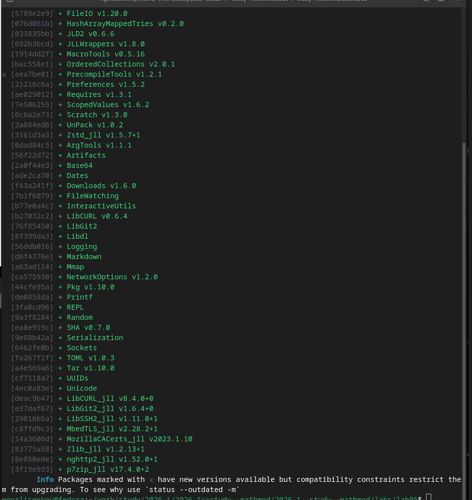{#fig:001 width=100%}

## Опции оформления и сохранение графика
Для ряда Тейлора функции синус заданы опции линии, отметок, шрифтов, поворота подписей, заливки области и цвета фона, теоретическая кривая добавлена функцией plot!, а график сохранён в файлы taylor.pdf и taylor.png.
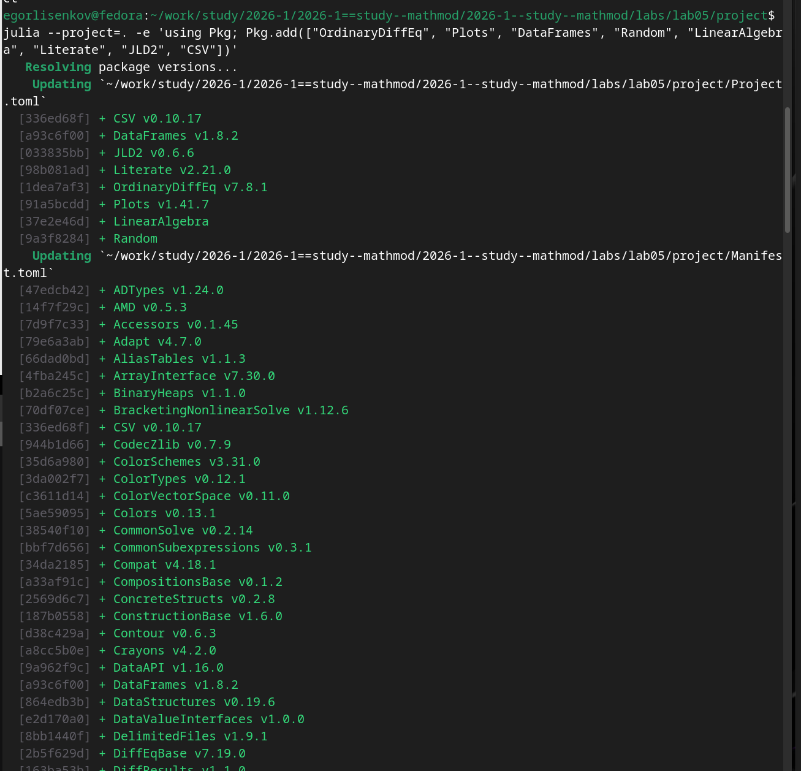{#fig:002 width=100%}

## Точечные графики на плоскости и в пространстве
Построены точечные графики случайных значений с кодированием третьей величины размером маркера, включая трёхмерную версию с подписанными осями и легендой.
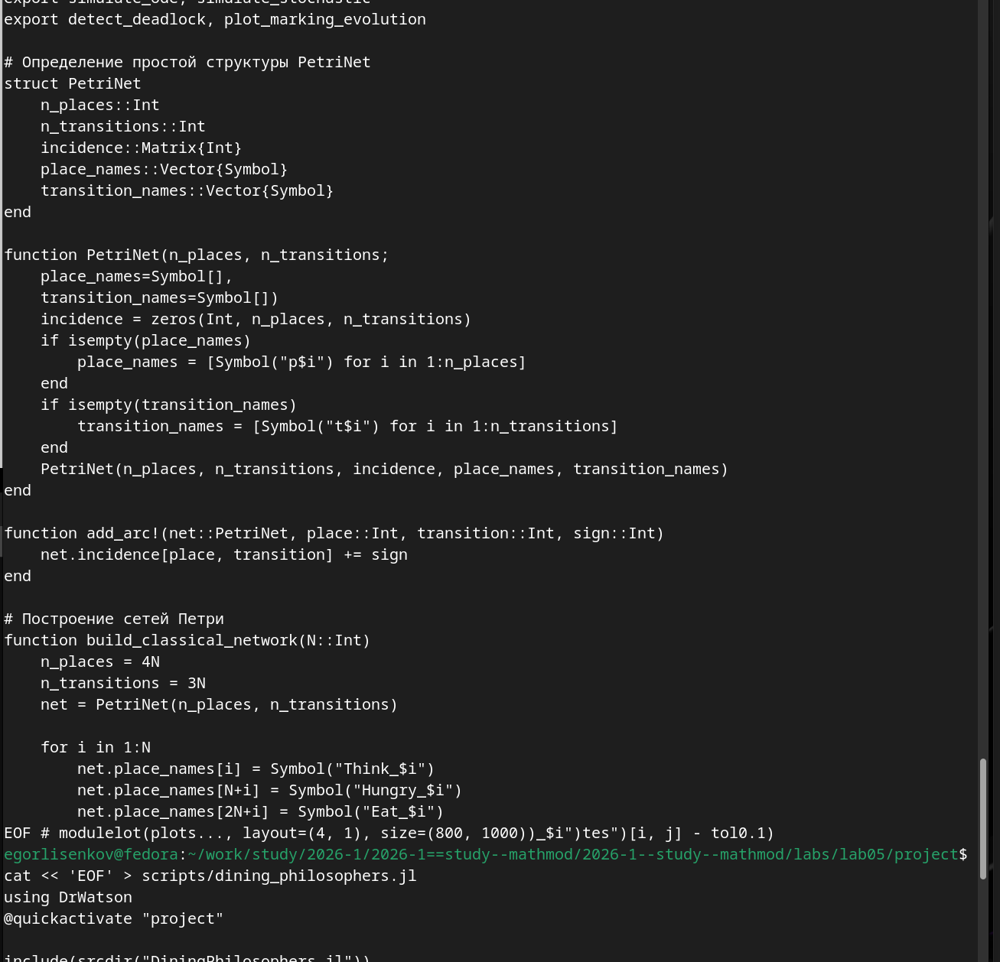{#fig:003 width=100%}

## Аппроксимация данных полиномом
Зашумлённые экспоненциальные данные из тысячи точек аппроксимированы полиномом пятой степени методом наименьших квадратов через решение матричного уравнения оператором обратного слэша.
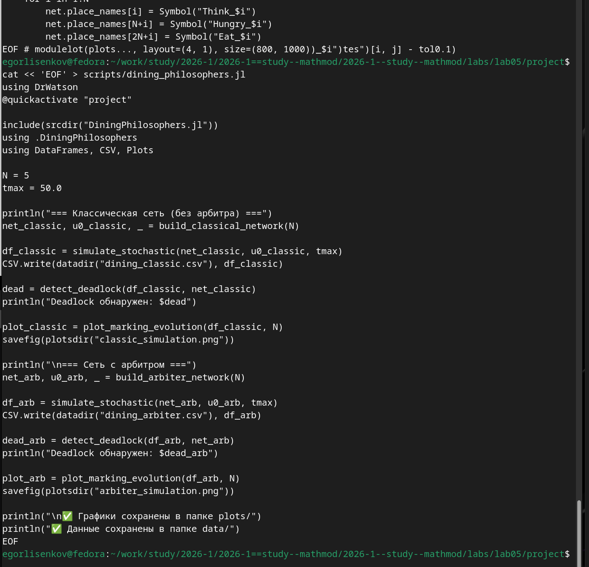{#fig:004 width=100%}

## Полярные координаты и параметрические кривые
Построены кривая в полярных координатах для функции r(θ) = 1 + cos θ sin² θ и параметрические кривые на плоскости в виде восьмёрки и в пространстве в виде винтовой линии.
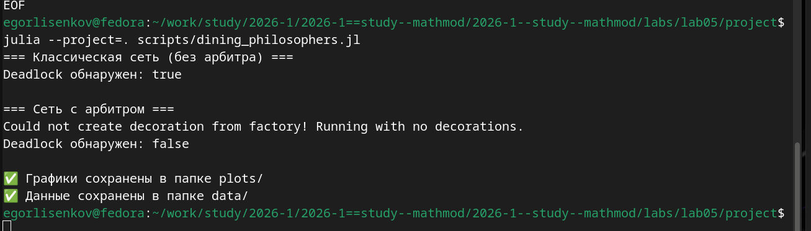{#fig:005 width=100%}

## Линии уровня и подготовка векторного поля
Для функции g(x, y) построены линии уровня без заливки и с заливкой с цветовой шкалой, а для функции h(x, y) = x³ − 3x + y² подготовлены поверхность и линии уровня для векторного поля.
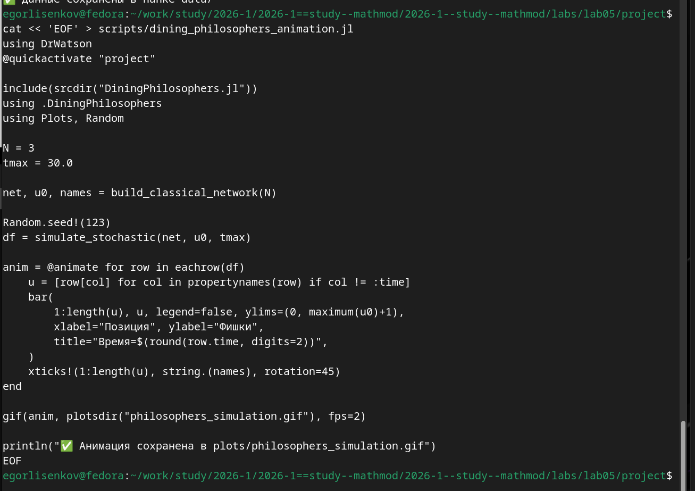{#fig:006 width=100%}

## Gif-анимация поверхности
Макросом gif построена анимация поверхности sin(x + 10 sin i) + cos y: кадры демонстрируют смещение гребней волн вдоль координаты x при изменении фазы.
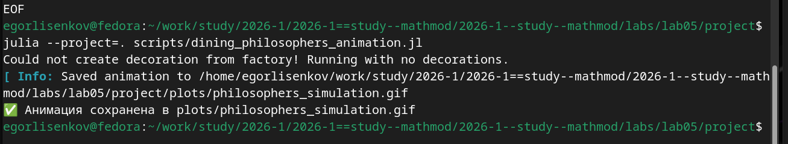{#fig:007 width=100%}

## Построение гипоциклоиды
Воспроизведены этапы построения гипоциклоиды при k = 3: большая окружность, частичная траектория, катящаяся малая окружность с радиусом до образующей точки, далее собранные в анимацию hypocycloid.gif.
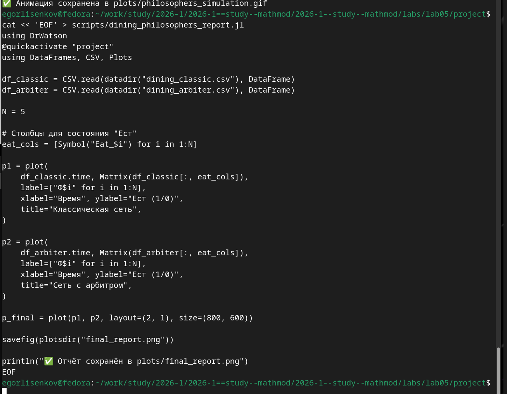{#fig:008 width=100%}

## Планки погрешностей и гистограммы
Ошибки измерений отображены горизонтальными планками и заливкой области ошибок через ribbon, а пакетом Distributions построены гистограммы равномерных и нормально распределённых данных.
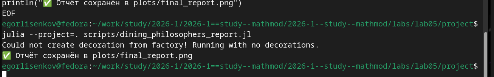{#fig:009 width=100%}

## Гистограмма и макеты подграфиков
Получена колоколообразная гистограмма нормального распределения и продемонстрированы макеты подграфиков: сетка 4x1, автоматическая сетка, панели разной высоты и объединение четырёх графиков в сетке 2x2.
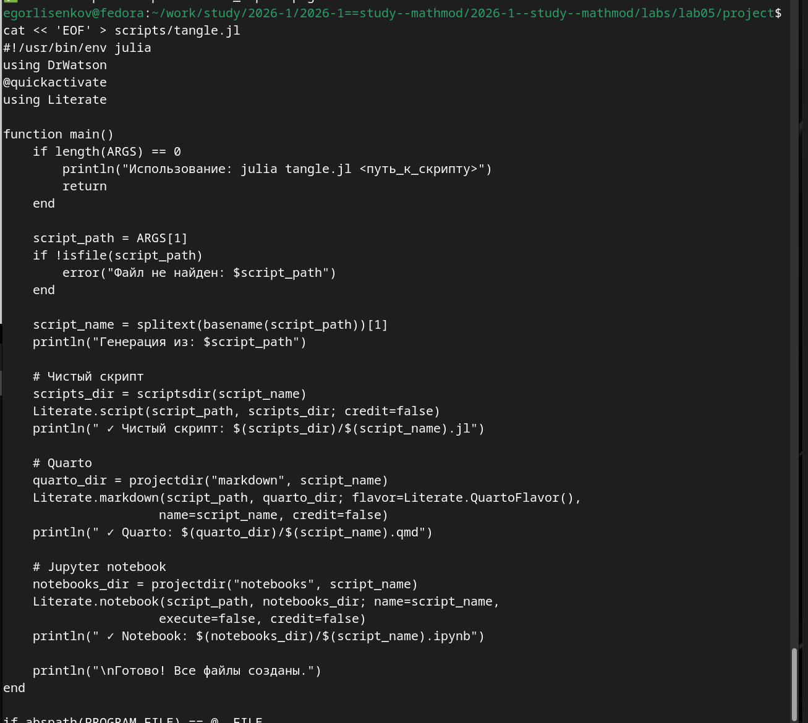{#fig:010 width=100%}

## Задание 1: все типы графиков синусоиды
Шесть представлений функции y = sin(x) — линии, точки, столбцы, ступени, палочки и гистограмма значений — объединены в одно окно макетом 3x2.
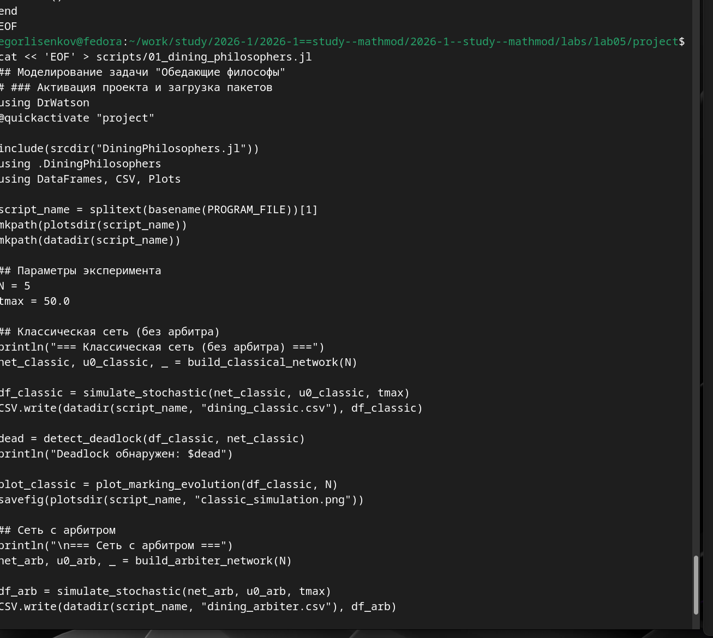{#fig:011 width=100%}

## Задание 2: типы оформления линий
Пять стилей линии solid, dash, dot, dashdot и dashdotdot продемонстрированы на кривой синуса в одном окне вертикальным макетом.
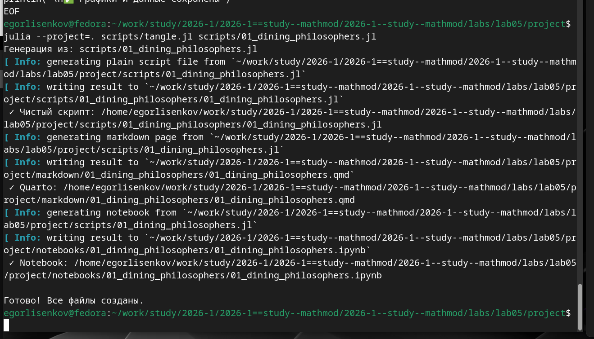{#fig:012 width=100%}

## Задания 5 и 6: две оси ординат и экспериментальные данные
Кривые y1 = π x и y2 = exp(x) cos(x) построены в едином масштабе с указанием недостатка и с двумя осями ординат через twinx, а экспериментальные данные линейной зависимости отображены с планками погрешностей и теоретической прямой.
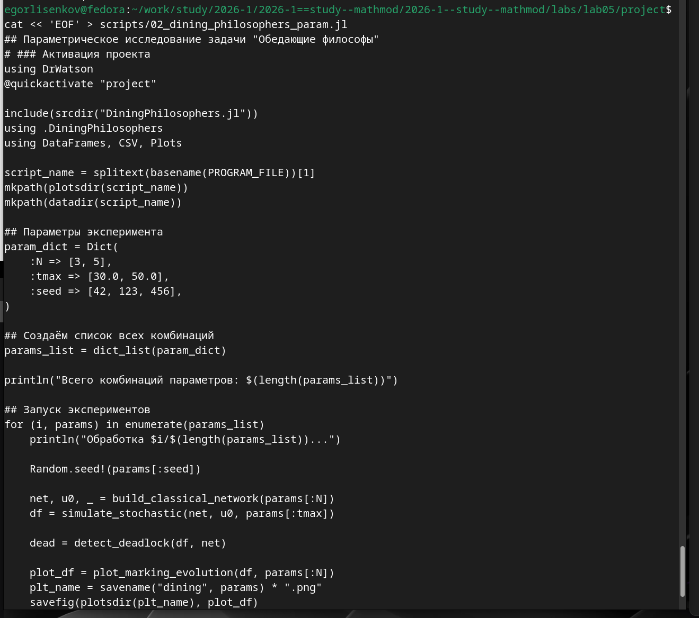{#fig:013 width=100%}

## Задания 10 и 11: анимации циклоид
Построены анимированные гипоциклоиды и эпициклоиды для целых k = 3, 4 и рациональных k = 5/2, 7/3 с сохранением восьми gif-файлов; приведён кадр эпициклоиды при k = 7/3 с петлями вне неподвижной окружности.
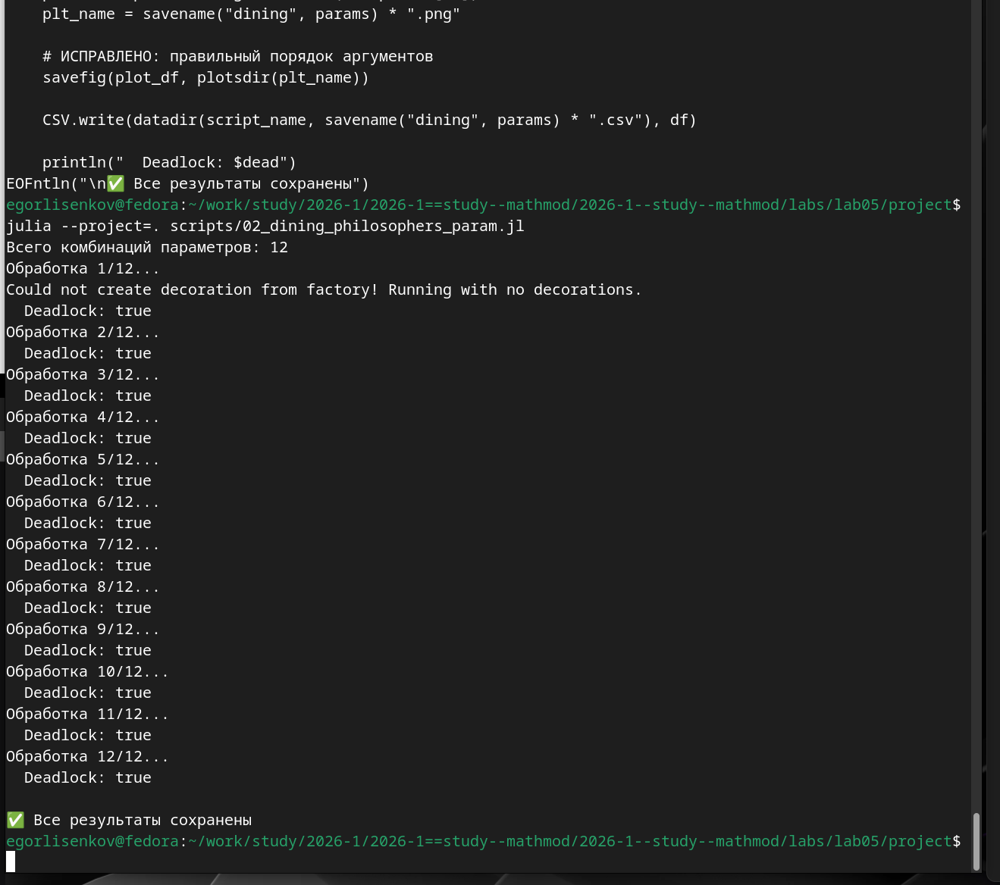{#fig:014 width=100%}

## Вывод
В ходе лабораторной работы освоен синтаксис языка Julia для построения графиков: смена бэкендов пакета Plots, опции оформления с сохранением в файлы, точечные графики, аппроксимация данных, полярные и параметрические кривые, линии уровня, gif-анимации, планки погрешностей, гистограммы и макеты подграфиков. Выполнены задания самостоятельной работы, включая объединение типов графиков и стилей линий в одном окне, построение кривых с двумя осями ординат, отображение экспериментальных данных с ошибками и анимации циклоид для целых и рациональных модулей k. Результаты зафиксированы в системе контроля версий Git.
