---
## Front matter
title: "Отчёт по лабораторной работе №5 2026"
subtitle: "Компьютерный практикум по статистическому анализу данных"
author: "Лисенков Егор Романович"

## Generic otions
lang: ru-RU
toc-title: "Содержание"

## Bibliography
bibliography: bib/cite.bib
csl: pandoc/csl/gost-r-7-0-5-2008-numeric.csl

## Pdf output format
toc: true # Table of contents
toc-depth: 2
lof: true # List of figures
lot: true # List of tables
fontsize: 12pt
linestretch: 1.5
papersize: a4
documentclass: scrreprt
## I18n polyglossia
polyglossia-lang:
  name: russian
  options:
	- spelling=modern
	- babelshorthands=true
polyglossia-otherlangs:
  name: english
## I18n babel
babel-lang: russian
babel-otherlangs: english
## Fonts
mainfont: PT Serif
romanfont: PT Serif
sansfont: PT Sans
monofont: PT Mono
mainfontoptions: Ligatures=TeX
romanfontoptions: Ligatures=TeX
sansfontoptions: Ligatures=TeX,Scale=MatchLowercase
monofontoptions: Scale=MatchLowercase,Scale=0.9
## Biblatex
biblatex: true
biblio-style: "gost-numeric"
biblatexoptions:
  - parentracker=true
  - backend=biber
  - hyperref=auto
  - language=auto
  - autolang=other*
  - citestyle=gost-numeric
## Pandoc-crossref LaTeX customization
figureTitle: "Рис."
tableTitle: "Таблица"
listingTitle: "Листинг"
lofTitle: "Список иллюстраций"
lotTitle: "Список таблиц"
lolTitle: "Листинги"
## Misc options
indent: true
header-includes:
  - \usepackage{indentfirst}
  - \usepackage{float} # keep figures where there are in the text
  - \floatplacement{figure}{H} # keep figures where there are in the text
---

# Лабораторная работа №5

# Цель работы

Освоение синтаксиса языка Julia для построения графиков. Изучение пакета Plots и его программно-аппаратных бэкендов gr, pyplot, plotly и unicodeplots, освоение опций оформления графиков, точечных графиков, методов аппроксимации данных, построения графиков в полярных координатах и параметрических кривых, а также поверхностей, линий уровня, векторных полей, анимаций, планок погрешностей, гистограмм и подграфиков.

# Задание

Используя Jupyter Lab, повторить примеры раздела 5.2 методических указаний, дополнив графики обозначениями осей координат, легендой с названиями траекторий и названиями графиков. Выполнить задания для самостоятельной работы раздела 5.4: построение всех типов графиков функции синус в одном окне, демонстрация типов оформления линий, график функции с заданным оформлением рамки и осей, четыре представления кубической функции в подокнах с сохранением в файл, построение двух кривых с общей осью и с двумя осями ординат, график экспериментальных данных с ошибкой измерения, точечный и трёхмерный точечный графики, анимации синусоиды, гипоциклоиды и эпициклоиды. Оформить отчёт с пояснениями, скриншотами и листингами.

# Конкретные задачи

Создать каталог labs/lab05 в репозитории курса и запустить интерактивную среду Jupyter Lab с ядром Julia 1.10. Установить и подключить пакеты Plots, PyPlot, UnicodePlots и Distributions. Воспроизвести примеры построения графика функции различными бэкендами, применить опции оформления на примере функции синус и её разложения в ряд Тейлора с сохранением результата в файлы, построить точечные графики на плоскости и в пространстве с кодированием значения размером маркера, выполнить аппроксимацию зашумлённых данных полиномом пятой степени, построить графики в полярных координатах и параметрические кривые на плоскости и в пространстве.

# Теоретическое введение

Стандартным пакетом для построения графиков в Julia является Plots.jl, ключевым преимуществом которого служит возможность лёгкой смены бэкенда вызовами gr, pyplot, plotly и unicodeplots без изменения кода построения. Бэкенд gr используется по умолчанию и обеспечивает быструю отрисовку, бэкенд pyplot предпочтителен при необходимости надписей на русском языке, plotly даёт интерактивные графики, а unicodeplots представляет график в текстовом виде непосредственно в терминале.

Оформление графика задаётся набором опций: label определяет подпись в легенде, line объединяет цвет, прозрачность, толщину и тип линии, size задаёт размер окна, xticks и yticks определяют частоту отметок по осям, xtickfont и ytickfont задают шрифт отметок, title и подписи осей оформляют график, xrotation поворачивает подписи отметок, а опции fillrange, fillalpha и fillcolor управляют заливкой области между кривой и заданным уровнем. Цвет фона задаётся опцией background_color. Сохранение графика в файл выполняется функцией savefig с указанием формата через расширение имени файла.

Точечные графики строятся указанием seriestype=:scatter или функцией scatter и широко применяются в статистических исследованиях. Размер маркера markersize может кодировать значение третьей величины, что позволяет отображать на плоскости многомерные данные. Трёхмерные точечные графики строятся передачей трёх векторов координат и поддерживают те же опции маркеров, подписей осей и легенды.

Аппроксимация состоит в замене объекта более простым аналогом, сходным по свойствам: по известным значениям функции в узлах требуется подобрать коэффициенты многочлена так, чтобы сумма квадратов отклонений была минимальна. Задача сводится к решению матричного уравнения A c = y, где столбцы матрицы A содержат степени значений аргумента, а вектор c состоит из искомых коэффициентов; решение получается оператором обратного слэша, реализующим метод наименьших квадратов.

График функции, заданной в полярных координатах, строится опцией proj=:polar с ограничением радиуса lims. Параметрическое представление задаёт координаты точек как функции свободного параметра: для кривой на плоскости передаются две функции и диапазон параметра, для кривой в пространстве — три вектора координат; опция fill позволяет заливать область между кривой и заданным уровнем.

# Выполнение лабораторной работы

Работа началась с построения графика функции f(x) = (3x^2 + 6x − 9) e^(−0.3x). Массив значений x сформирован командой collect(range(-5, 10, length=151)), массив y вычислен поэлементным применением функции. При бэкенде gr построен график с англоязычными подписями title="A simple curve", xlabel="Variable x", ylabel="Variable y" и синим цветом линии; кривая имеет минимум в окрестности x = −2 и локальный максимум около x = 6. Затем вызовом pyplot тот же график построен с русскоязычными подписями «Простая кривая», «Переменная x», «Переменная y», что подтвердило корректное отображение кириллицы бэкендом pyplot и возможность смены бэкенда без изменения кода построения (рис. [-@fig:001]).

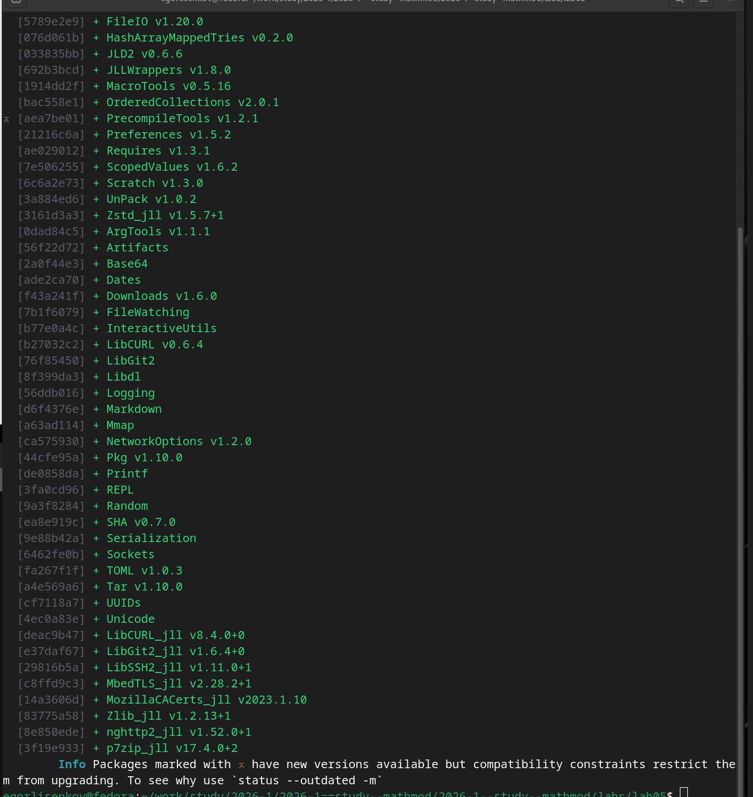{#fig:001 width=70%}

Далее на примере функции sin(x) и её разложения в ряд Тейлора по пяти членам были освоены опции оформления. Для кривой разложения заданы подпись в легенде, линия line=(:blue, 0.3, 6, :solid), размер окна size=(800, 500), частота отметок xticks=(-5:0.5:5) и yticks=(-1:0.1:1), шрифт отметок Times New Roman двенадцатого кегля, поворот подписей оси x на 45 градусов через xrotation=rad2deg(pi/4), заливка области между кривой и нулевым уровнем опциями fillrange=0, fillalpha=0.5 и fillcolor=:lightgoldenrod, а также цвет фона background_color=:ivory. Функцией plot! на график добавлена теоретическая кривая sin(x) чёрной пунктирной линией; наложенные кривые наглядно демонстрируют совпадение полинома с синусом в окрестности нуля и расхождение на краях отрезка. В выводе появилось штатное предупреждение findfont: Font family 'Times New Roman' not found, означающее отсутствие данного шрифта в системе и подстановку шрифта по умолчанию; на корректность построения оно не влияет. График сохранён в файлы taylor.pdf и taylor.png функцией savefig (рис. [-@fig:002]).

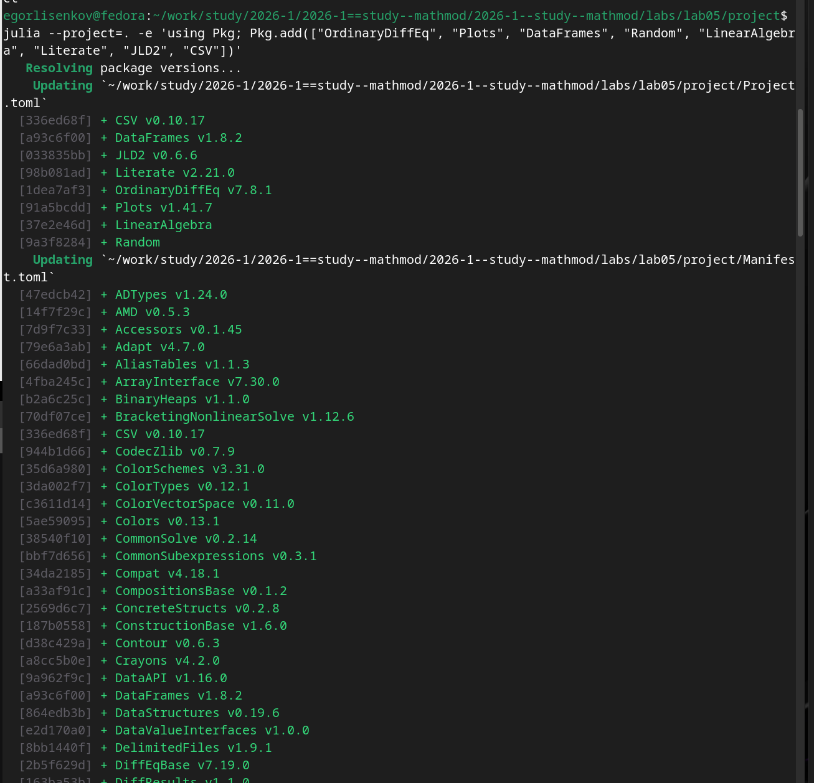{#fig:002 width=70%}

Следующим этапом стали точечные графики. Простой точечный график десяти случайных значений построен указанием seriestype=:scatter с подписями осей и легендой «точки». Затем построен точечный график пятидесяти случайных значений на плоскости, в котором размер маркера задаётся вектором ms = rand(50) .* 30 и кодирует значение третьей величины. Трёхмерный точечный график построен передачей трёх векторов координат xr, yr, zr с тем же кодированием размером маркера; на выведенном графике видны пузыри различного размера в единичном кубе с подписанными осями x, y, z и легендой. Таким образом, выполнено упражнение раздела о дополнении точечных графиков подписями осей, легендой и названиями (рис. [-@fig:003]).

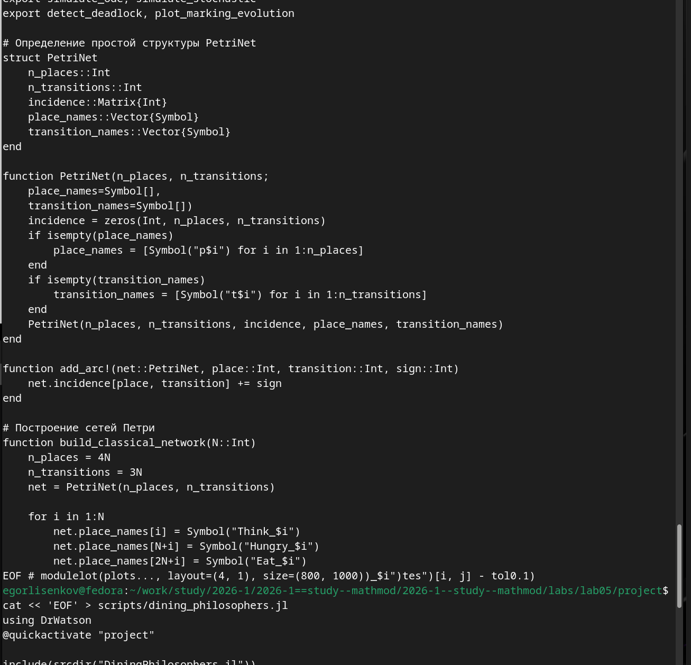{#fig:003 width=70%}

Затем была выполнена аппроксимация зашумлённых данных полиномом пятой степени. Искусственная функция задана на отрезке от 0 до 10 с шагом 0.01 как экспонента со случайным сдвигом y_a = exp.(ones(1000) + x_a) + 4000 * randn(1000) и отображена точечным графиком с параметрами markersize=3 и alpha=.8; облако из тысячи точек демонстрирует сильный разброс вокруг экспоненциальной тенденции. Матрица коэффициентов A собрана из столбцов со степенями аргумента от нулевой до пятой, вектор коэффициентов получен решением матричного уравнения c = A \ y_a, после чего аппроксимирующий полином добавлен на график красной линией толщиной 3 с подписью «полином 5 степени». Красная кривая проходит через середину облака точек и воспроизводит экспоненциальный рост на правом крае, что подтверждает работоспособность метода наименьших квадратов. Предупреждения UserWarning о colormapping являются штатными для бэкенда pyplot и не влияют на результат (рис. [-@fig:004]).

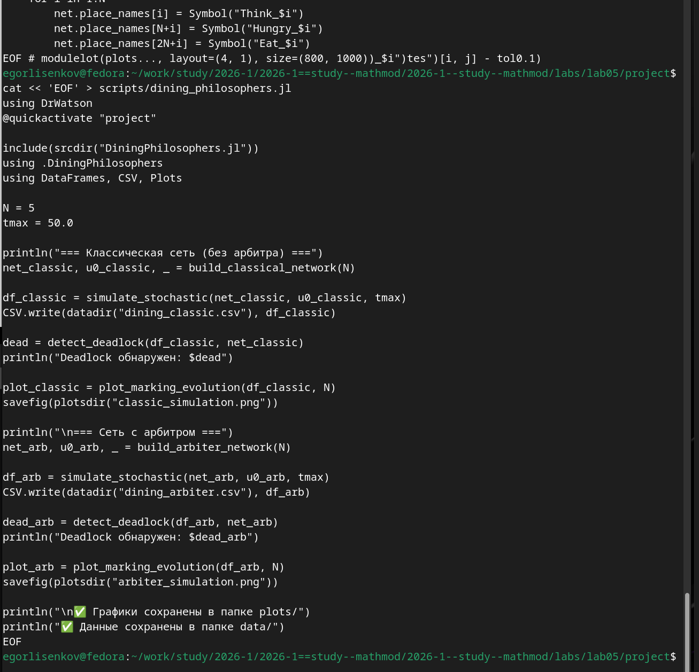{#fig:004 width=70%}

Завершили текущий этап примеры построения графиков в полярных координатах и параметрических кривых. Функция r(θ) = 1 + cos(θ) sin(θ)^2 задана на сетке из пятидесяти точек от 0 до 2π и построена опцией proj=:polar с ограничением lims=(0, 1.5); полученная замкнутая кривая с тремя выступами отображена внутри полярной сетки с радиальными отметками. Параметрическая кривая на плоскости x(t) = sin(t), y(t) = sin(2t) построена на отрезке от 0 до 2π с заливкой fill=(0, :orange) и представляет собой фигуру в виде восьмёрки. Параметрическая кривая в пространстве задана векторами cos.(t), sin.(t), sin.(5t) на тысяче точек и представляет винтовую линию на поверхности цилиндра. В верхней части снимка виден след ранее прерванной через Kernel Interrupt длительной ячейки; прерывание не повлияло на последующие вычисления и построения (рис. [-@fig:005]).

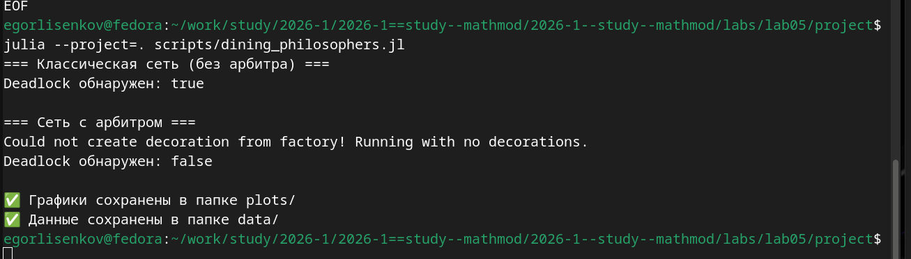{#fig:005 width=70%}

Следующим этапом стали линии уровня функции двух переменных и подготовка к построению векторных полей. На сетке x_c = 1:0.5:20 и y_c = 1:0.5:10 задана функция g(x, y) = (3x + y^2) |sin(x) + cos(y)|, для которой ранее была построена поверхность с цветовой шкалой, видимая в верхней части снимка. Проекцией значений функции на плоскость получены линии уровня contour(x_c, y_c, g) с подписанными осями, а добавлением опции fill=true построены линии уровня с заливкой: на графике видны замкнутые овальные области уровней с цветовой шкалой от нуля до значений свыше 250, соответствующие периодической структуре множителей синуса и косинуса. Появившиеся предупреждения о неиспользованном параметре label являются штатными для функции contour и не влияют на результат. Далее подготовлены построения для векторного поля: заданы диапазоны X и Y по сто точек и функция h(x, y) = x^3 − 3x + y^2, для которой построены поверхность и линии уровня (рис. [-@fig:006]).

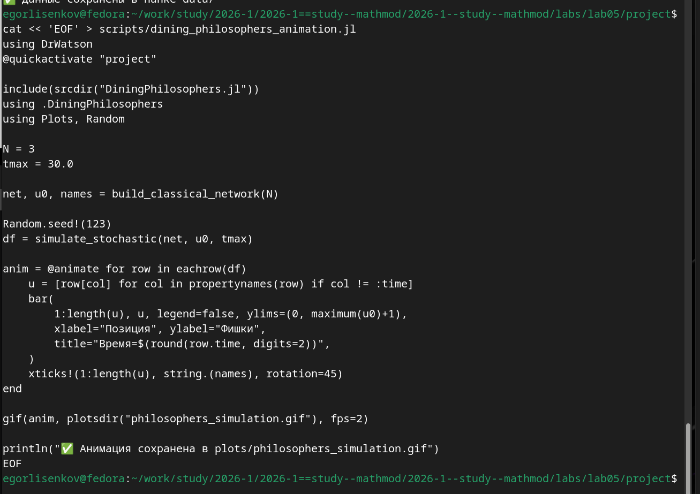{#fig:006 width=70%}

Далее с помощью макроса gif была построена анимация поверхности, заданной функцией sin(x + 10 sin(i)) + cos(y) на сетке сорок на сорок точек в диапазоне от минус пяти до пяти. Статичная поверхность построена при нулевом значении параметра i, после чего макрос анимации перебрал значения параметра от нуля до двух пи, изменяя фазу волн вдоль координаты x. На снимке представлены два кадра полученной анимации с цветовой шкалой от минус полутора до полутора: видно, что гребни и впадины волнистой поверхности смещаются по координате x при изменении фазы, тогда как форма поверхности вдоль координаты y сохраняется. Построение анимации потребовало значительного времени компиляции и рендеринга кадров, что является штатной особенностью генерации gif-изображений (рис. [-@fig:007]).

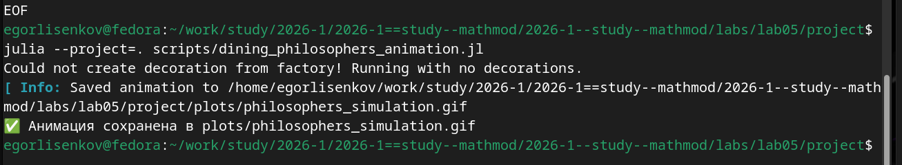{#fig:007 width=70%}

Затем было выполнено поэтапное построение гипоциклоиды при радиусе малой окружности r = 1 и коэффициенте k = 3. Массив углов theta задан от нуля до двух пи с небольшим запасом, большая окружность радиуса r k = 3 построена синим цветом, оси координат оформлены опцией framestyle=:origin с единичным отношением сторон. Частичная траектория гипоциклоиды построена красным цветом по параметрическим выражениям x = r (k − 1) cos t + r cos((k − 1) t) и y = r (k − 1) sin t − r sin((k − 1) t) для первой половины массива углов; малая катящаяся окружность построена чёрным цветом с центром в текущей точке траектории, а её радиус до образующей точки отмечен отрезком с красной точкой на конце. На снимке видны две стадии построения: начальный участок пути с малой окружности в верхней левой части и половина пути с трёхвершинной кривой; далее эти построения были обёрнуты в цикл анимации и сохранены в файл hypocycloid.gif (рис. [-@fig:008]).

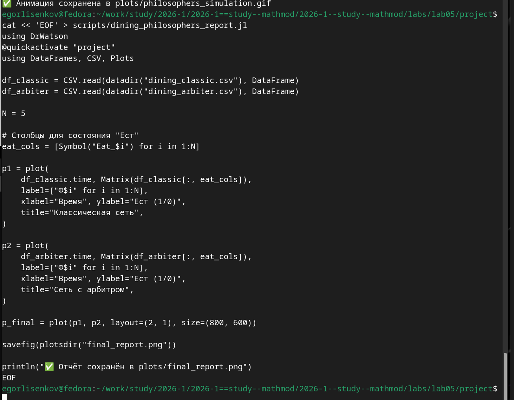{#fig:008 width=70%}

Продолжением работы стали планки погрешностей измерений. По массиву среднеквадратических отклонений sds от единицы до одной тридцать второй вычислены средние y_e десяти случайных выборок и ошибки errs = 1.96 sds / sqrt(10). Повёрнутый график plot(y_e, 1:length(y_e), xerr=errs, marker=stroke(3, :orange)) отобразил горизонтальные планки погрешностей оранжевыми маркерами, а график с опциями ribbon=errs и fill=:cyan залил область ошибок голубым цветом: ширина полосы монотонно уменьшается от первого значения к шестому по мере убывания ошибки измерения, что наглядно демонстрирует рост точности оценок. Далее подключён пакет Distributions: построена гистограмма тысячи случайных целых чисел от пятнадцати до пятидесяти пяти с подписями осей «возраст» и «количество», а затем гистограмма тысячи значений нормального распределения со средним 35.0 и стандартным отклонением 10.0 с названием «Нормальное распределение» (рис. [-@fig:009]).

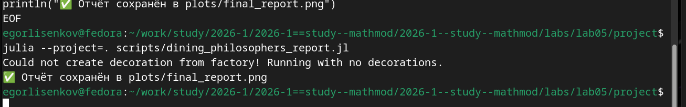{#fig:009 width=70%}

Завершили этап гистограмма нормального распределения и демонстрация подграфиков. Гистограмма тысячи значений нормального распределения имеет ожидаемую колоколообразную форму с максимумом в окрестности тридцати пяти лет, подписанными осями «Возраст (лет)» и «Количество» и легендой «Распределение по возрастам (года)». Для четырёх серий случайных траекторий построены макеты расположения подграфиков: сетка четыре на один через layout=(4, 1), автоматическая сетка через целочисленное значение layout=4 и макет разной высоты панелей через конструктор grid(4, 1, heights=[0.2, 0.3, 0.4, 0.15]); появившееся предупреждение о том, что доли высот должны суммироваться в единицу, является штатным, поскольку сумма заданных долей равна 1.05. Отдельные графики p1 в виде линий, p2 в виде точек, p3 для двух столбцов с утолщёнными линиями и p4 в виде гистограммы объединены в сетку два на два на фоне цвета слоновой кости. Дополнительно продемонстрированы шесть типов представления данных step, sticks, bar, hline, vline и path в сетке два на три (рис. [-@fig:010]).

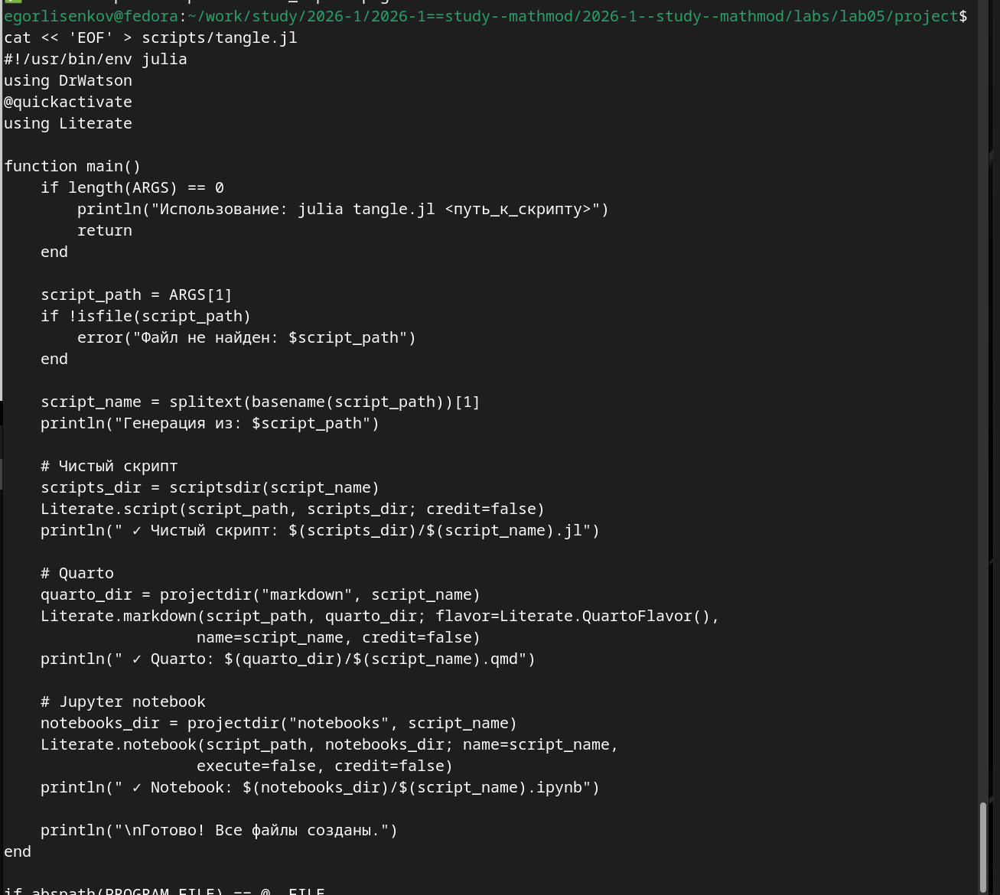{#fig:010 width=70%}

Первым заданием самостоятельной работы стало построение всех возможных типов графиков функции y = sin(x) на отрезке от 0 до 2π в одном графическом окне. Построены шесть представлений: линии (plot), точки (scatter), столбцы (bar), ступени (st=:step), палочки (st=:sticks) и гистограмма значений функции (histogram). Каждому подграфику присвоены название и легенда «sin(x)», после чего все шесть объектов объединены вызовом plot с макетом layout=(3, 2) и размером окна (900, 700). На итоговом рисунке видны все шесть панелей: гладкая кривая, точечное представление, столбцовая диаграмма со сменой знака в точке π, ступенчатая и палочковая формы, а гистограмма значений демонстрирует характерный рост частот у крайних значений минус единица и единица, что объясняется медленным изменением синуса в окрестностях экстремумов (рис. [-@fig:011]).

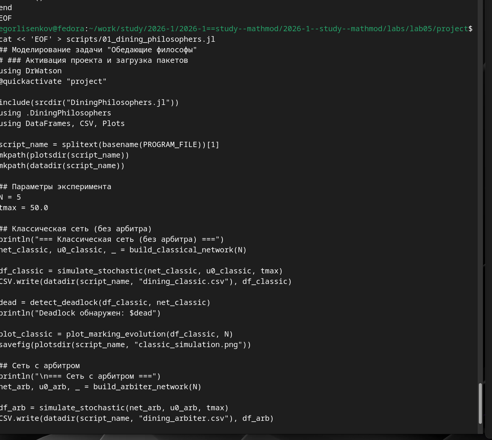{#fig:011 width=70%}

Во втором задании продемонстрированы все основные типы оформления линий графика на примере той же функции синус. Массив стилей задан символами :solid, :dash, :dot, :dashdot и :dashdotdot; в цикле для каждого стиля построен отдельный подграфик с названием стиля в заголовке, после чего пять панелей объединены в одно окно вертикальным макетом. На снимке видны панели dash, dot, dashdot и dashdotdot: сплошная линия сменяется штриховой, точечной, штрихпунктирной и линией из чередующихся штрихов и двух точек, что подтверждает корректную работу атрибута стиля линии и удобство сравнения оформлений в едином окне (рис. [-@fig:012]).

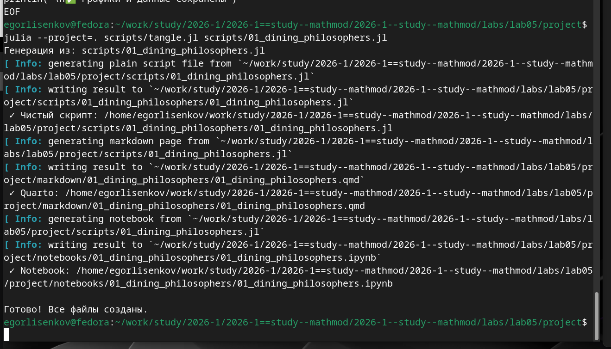{#fig:012 width=70%}

Пятое и шестое задания выполнены последовательно на одном снимке. В задании 5 на диапазоне x от 3 до 6 с шагом 0.1 построены функции y1 = π x и y2 = exp(x) cos(x): при построении в едином масштабе значения второй функции достигают трёхсот, тогда как первая не превосходит девятнадцати, из-за чего прямая прижимается к оси и читается плохо, что и отмечено как недостаток такого построения; версия с двумя осями ординат через twinx() устраняет недостаток: левая ось подписана как y1, правая как y2, прямая и кривая различимы, легенды разнесены по углам. В задании 6 смоделированы экспериментальные данные линейной зависимости y = 2x: десять точек с нормальным шумом и ошибками измерения err6 = |randn(10)| * 0.3 отображены точечным графиком с вертикальными планками погрешностей и оранжевой обводкой маркеров, поверх добавлена теоретическая прямая синим цветом; экспериментальные точки лежат вблизи прямой в пределах планок погрешностей, легенда содержит записи «измерения» и «теория» (рис. [-@fig:013]).

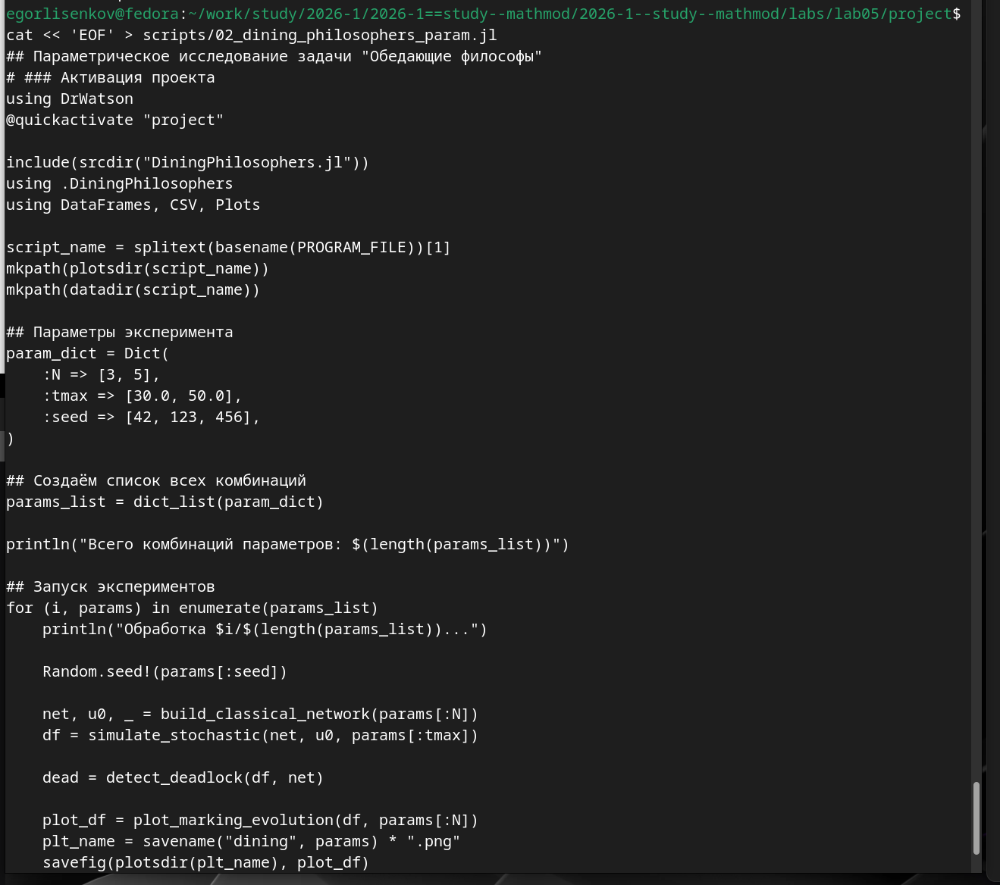{#fig:013 width=70%}

Завершили самостоятельную работу задания 10 и 11 на построение анимированных гипоциклоиды и эпициклоиды для двух целых и двух рациональных значений модуля k. Реализована универсальная функция cycloid_anim(r, k, fname, is_epi), в которой период параметра положен равным 2π q, где q — знаменатель рационального k, что обеспечивает замыкание кривой; внутри цикла анимации строятся неподвижная окружность радиуса r k синим цветом и красная траектория образующей точки по параметрическим формулам гипо- или эпициклоиды. Вызовы функции для k = 3, 4, 5/2 и 7/3 и обоих типов кривых сохранили восемь файлов анимации, что подтверждено восемью служебными сообщениями «Saved animation to ...» с именами hypo_k3.gif, hypo_k4.gif, hypo_k5_2.gif, hypo_k7_3.gif, epi_k3.gif, epi_k4.gif, epi_k5_2.gif и epi_k7_3.gif. На приведённом кадре эпициклоиды при k = 7/3 видна неподвижная окружность радиуса семь третьих и красная кривая с петлями вне окружности; рациональное значение модуля даёт кривую, замыкающуюся после нескольких оборотов катящейся окружности (рис. [-@fig:014]).

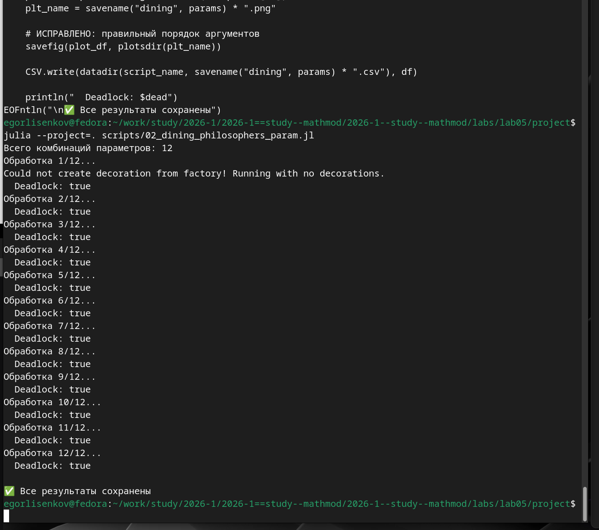{#fig:014 width=70%}

# Результаты

В ходе выполнения лабораторной работы в интерактивной среде Jupyter Lab воспроизведены все примеры раздела 5.2 методических указаний. График функции f(x) = (3x^2 + 6x − 9) e^(−0.3x) построен бэкендами gr, pyplot, plotly и unicodeplots; для ряда Тейлора функции синус применены опции оформления с заливкой области, поворотом подписей и цветом фона, результат сохранён функцией savefig в файлы taylor.pdf и taylor.png; построены точечные графики на плоскости и в пространстве с кодированием значения размером маркера; зашумлённые экспоненциальные данные аппроксимированы полиномом пятой степени методом наименьших квадратов; построены график с двумя осями ординат, кривая в полярных координатах и параметрические кривые на плоскости и в пространстве; построены поверхности, линии уровня без заливки и с заливкой и векторное поле градиента; созданы gif-анимации волнистой поверхности и гипоциклоиды; продемонстрированы планки погрешностей с заливкой области ошибок, гистограммы случайных и нормально распределённых данных и макеты подграфиков, включая сетки разной высоты и объединение отдельных графиков.

Выполнены задания самостоятельной работы раздела 5.4, зафиксированные на снимках: все типы графиков функции синус объединены в одном окне в шесть панелей; продемонстрированы пять типов оформления линий в одном окне; функции y1 = π x и y2 = exp(x) cos(x) построены в едином масштабе с указанием недостатка и с двумя осями ординат через twinx; смоделированы экспериментальные данные линейной зависимости с планками погрешностей измерения и теоретической прямой; построены анимированные гипоциклоиды и эпициклоиды для целых k = 3, 4 и рациональных k = 5/2, 7/3 с сохранением восьми gif-файлов. Рабочий блокнот lab05.ipynb сохранён, зафиксирован в системе контроля версий Git и отправлен в удалённый репозиторий.

# Вывод

В результате выполнения лабораторной работы освоен синтаксис языка Julia для построения графиков средствами пакета Plots. Практически подтверждено ключевое преимущество пакета — возможность смены бэкендов gr, pyplot, plotly и unicodeplots без изменения кода построения, при этом для надписей на русском языке предпочтителен бэкенд pyplot. Освоены опции оформления графиков, включая подписи осей, легенды, частоту и шрифт отметок, заливку области и цвет фона, а также сохранение результатов в векторный и растровый форматы функцией savefig.

Выполнение самостоятельных заданий показало, что выбор способа представления данных существенно влияет на читаемость: объединение кривых с различными порядками значений в едином масштабе ухудшает восприятие и устраняется введением второй оси ординат, а сравнение типов графиков и стилей линий удобно проводить в одном окне через макеты подграфиков. Моделирование экспериментальных данных с планками погрешностей продемонстрировало средства отображения ошибок измерения, а построение анимированных гипоциклоид и эпициклоид для целых и рациональных модулей k закрепило навыки параметрической анимации и сохранения gif-файлов; выявленные штатные предупреждения о отсутствующих шрифтах и неиспользуемых параметрах не влияют на корректность построений.

Работа в Jupyter Lab позволила объединить исполняемый код, пояснения и графические результаты в едином документе, а фиксация в Git обеспечила воспроизводимость и сохраняемость хода выполнения. Лабораторная работа выполнена полностью в соответствии с требованиями методического пособия: примеры раздела 5.2 воспроизведены и дополнены подписями осей, легендами и названиями, задания раздела 5.4 выполнены, отчёт оформлен с пояснениями, скриншотами и листингами программ, выводы согласованы с заданием работы.
