---
## Front matter
lang: ru-RU
title: Лабораторная работа №6
subtitle: Компьютерный практикум по статистическому анализу данных
author:
  - Лисенков Е.Р.
institute:
  - Российский университет дружбы народов, Москва, Россия

## i18n babel
babel-lang: russian
babel-otherlangs: english

## Formatting pdf
toc: false
toc-title: Содержание
slide_level: 2
aspectratio: 169
section-titles: true
theme: metropolis
header-includes:
 - \metroset{progressbar=frametitle,sectionpage=progressbar,numbering=fraction}
 - '\makeatletter'
 - '\beamer@ignorenonframefalse'
 - '\makeatother'
---

# Информация

## Докладчик

:::::::::::::: {.columns align=center}
::: {.column width="70%"}

  * Лисенков Егор Романович
  * студент НФИбд-02-23
  * Российский университет дружбы народов
  * [1132232881@rudn.ru](mailto:1132232881@rudn.ru)
  * <https://github.com/erlisenkov>

:::
::: {.column width="30%"}

ц

:::
::::::::::::::

# Вводная часть

## Актуальность
Модели в непрерывном и дискретном времени составляют основу описания популяционных, эпидемических и колебательных процессов, а их численное решение требует верифицированных методов интегрирования.

## Объект и предмет исследования
Объектом выступают модели непрерывного и дискретного времени, а предметом — численное решение обыкновенных дифференциальных уравнений и нелинейных отображений методом Рунге–Кутты четвёртого порядка с контролем точности.

## Цели и задачи
Целью работы является освоение методов решения задач в непрерывном и дискретном времени, а задачами — воспроизведение примеров методических указаний и реализация восьми самостоятельных моделей с анализом их свойств.

## Материалы и методы
Работа выполнена в операционной системе Fedora с использованием языка Julia версии 1.10.3 и среды Jupyter Lab, собственной реализации метода Рунге–Кутты с автоматическими проверками и системы контроля версий Git.

## Примеры раздела 6.2: экспонента, Лоренц, Лотка–Вольтерра
Воспроизведены постановки трёх моделей, а уравнение экспоненциального роста решено методом Рунге–Кутты с отклонением от аналитического решения 1.99e-10.
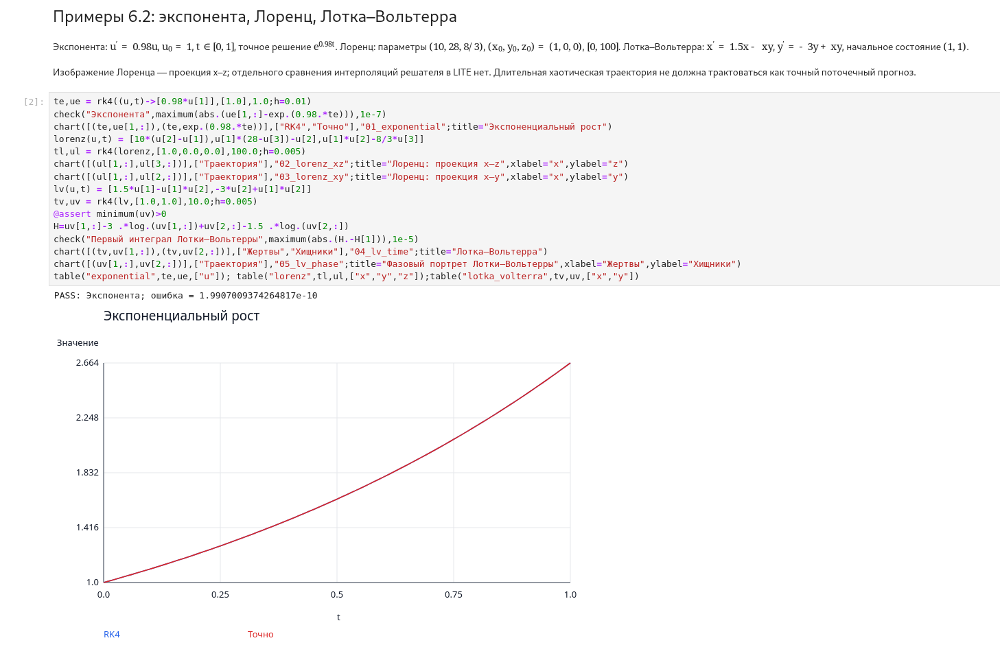{#fig:001 width=100%}

## Проекции аттрактора Лоренца
Проекции траектории на плоскости x–z и x–y продемонстрировали структуру странного аттрактора в виде бабочки с хаотическими переходами между двумя неустойчивыми равновесиями.
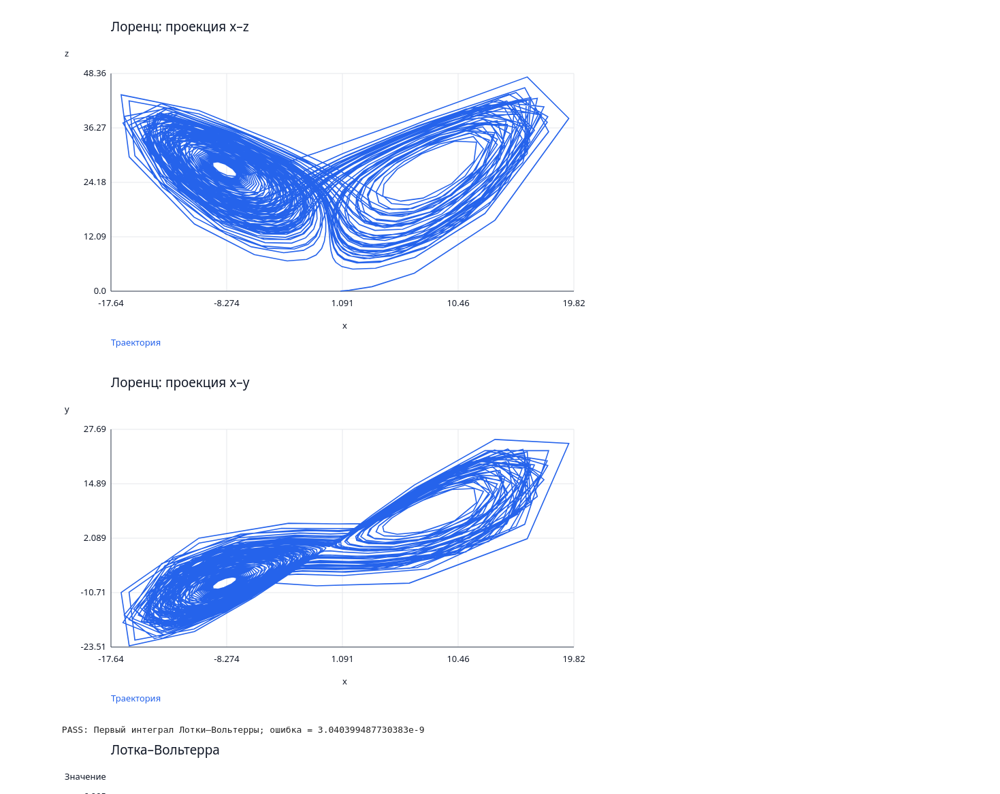{#fig:002 width=100%}

## Модель Лотки–Вольтерры
Получены противофазные периодические колебания численностей жертв и хищников и замкнутый фазовый портрет с сохранением первого интеграла с точностью 3.04e-9.
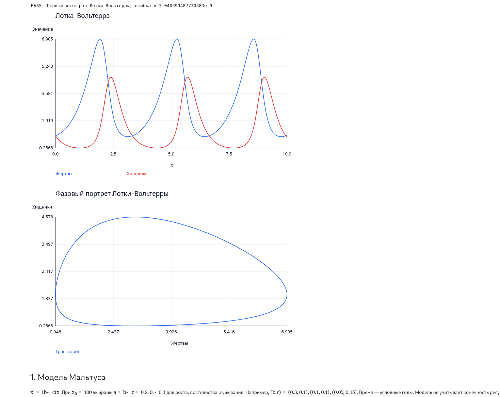{#fig:003 width=100%}

## Задания 1 и 2: модель Мальтуса и логистика
Реализованы три режима модели Мальтуса с проверкой против точного решения и подготовлена логистическая модель для трёх начальных условий ниже и выше ёмкости среды.
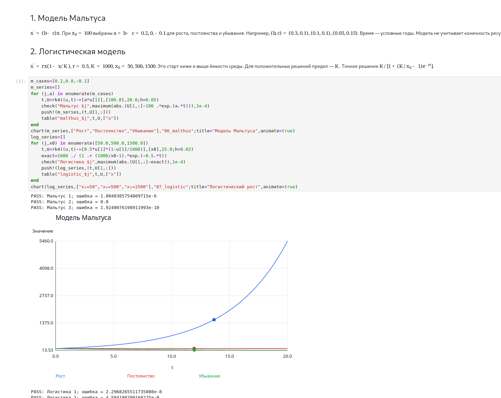{#fig:004 width=100%}

## Логистический рост и постановка SIR и SEIR
Кривые с разными начальными условиями сошлись к ёмкости среды K = 1000, а для моделей эпидемии сформулированы проверки сохранения населения и неотрицательности решений.
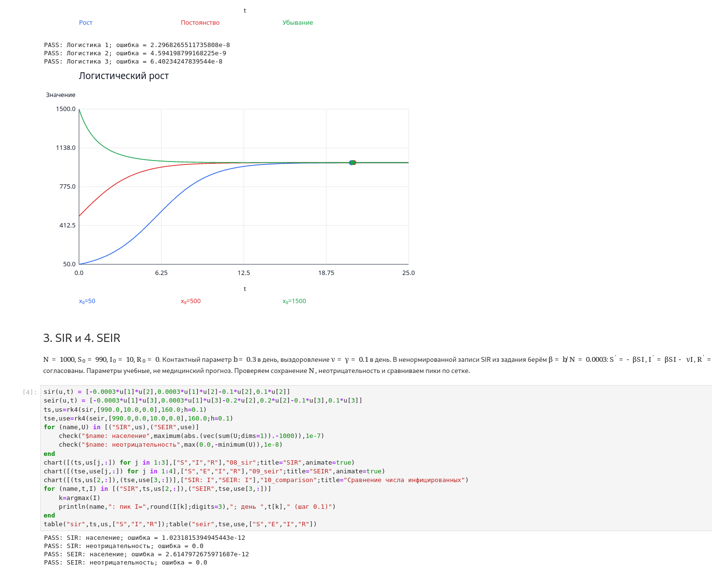{#fig:005 width=100%}

## Задания 3 и 4: динамика SIR и SEIR
Модели сохранили численность популяции с точностью до 1e-12, а график SIR показал убывание восприимчивых, пик инфицированных и плато переболевших.
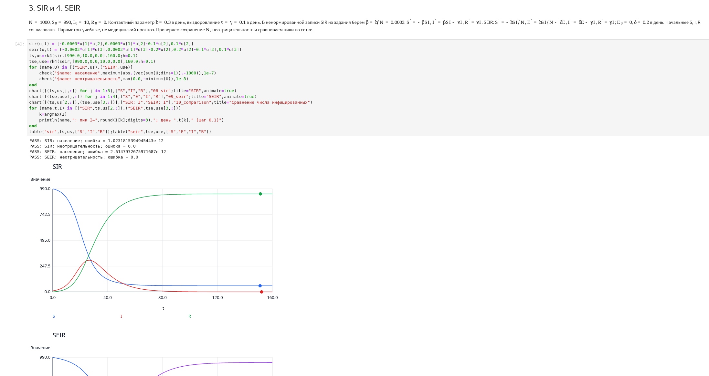{#fig:006 width=100%}

## Сравнение пиков эпидемии
Латентная стадия SEIR сдвинула и сгладила пик инфицированных: 303.811 на день 26.6 в SIR против 198.605 на день 51.0 в SEIR.
{#fig:007 width=100%}

## Задание 5: дискретная модель Лотки–Вольтерры
Точки равновесия проверены подстановкой, устойчивость положительного фокуса подтверждена итерациями отображения с ошибкой сходимости 2.14e-10 и расхождением с линеаризацией 6.01e-6.
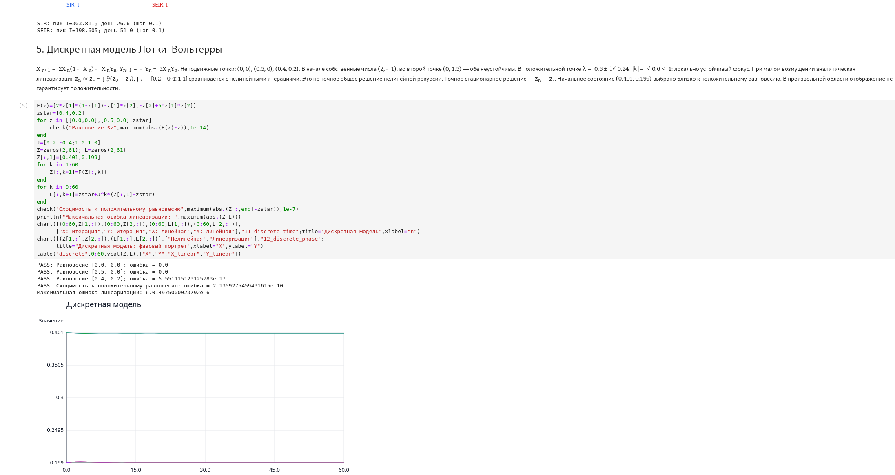{#fig:008 width=100%}

## Фазовый портрет дискретной модели и конкурентный отбор
Спираль сошлась к положительному равновесию, а в модели конкуренции проверено аналитическое усиление начальной разности популяций с ошибкой 1.03e-8.
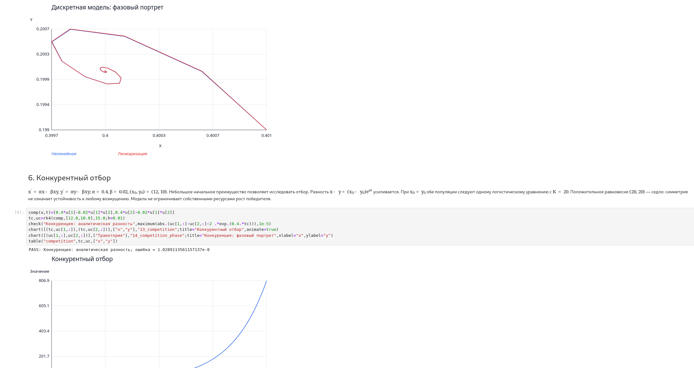{#fig:009 width=100%}

## Фазовый портрет конкуренции и осцилляторы
Проигравшая популяция вымерла при неограниченном росте победителя, а уравнения осциллятора подготовлены к сравнению с точными решениями для двух значений затухания.
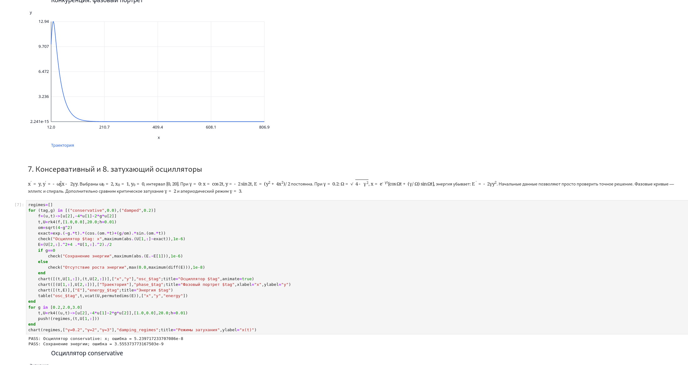{#fig:010 width=100%}

## Задание 7: консервативный осциллятор
Численное решение совпало с cos 2t с ошибкой 5.24e-8, а фазовый портрет представил замкнутый эллипс, соответствующий сохранению энергии.
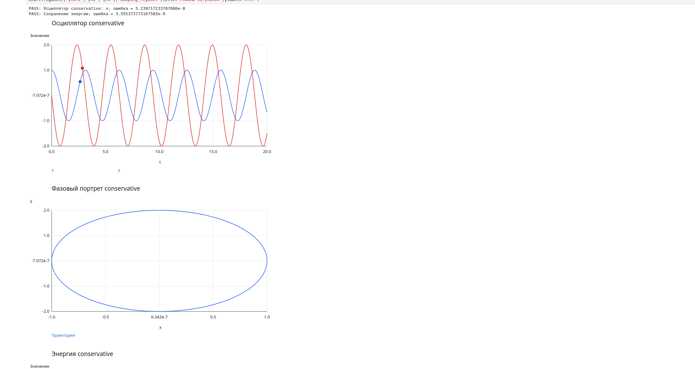{#fig:011 width=100%}

## Энергия и затухающий осциллятор
Энергия консервативной системы сохранилась на уровне машинной точности, а решение при затухании 0.2 сверено с точной формулой с ошибкой 4.93e-9 без роста энергии.
{#fig:012 width=100%}

## Задание 8: спираль и убывание энергии
Фазовая траектория стянулась спиралью к положению равновесия, а энергия монотонно убывала от 2.0 до 6.2e-4 в соответствии с законом диссипации.
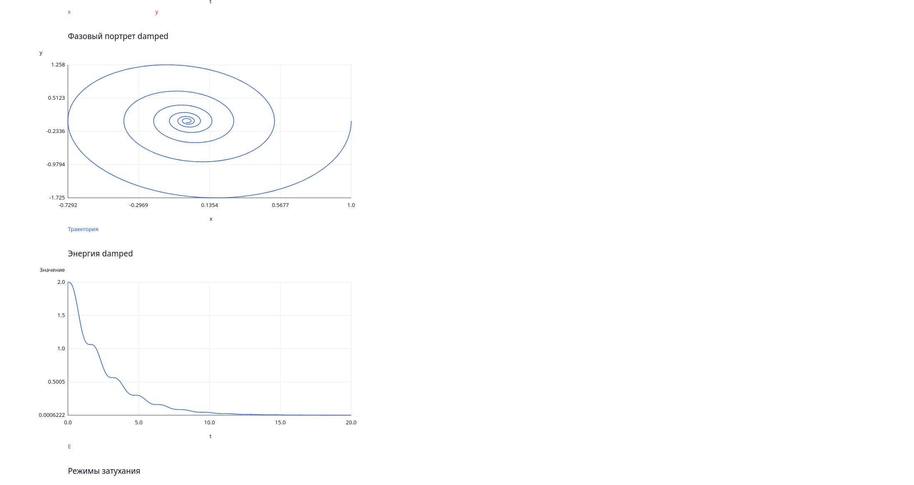{#fig:013 width=100%}

## Режимы затухания и контроль шага
Сопоставлены колебательный, критический и апериодический режимы, а уменьшение ошибки в 16 раз при сгущении сетки вдвое подтвердило четвёртый порядок точности метода при 21 проверке со статусом PASS.
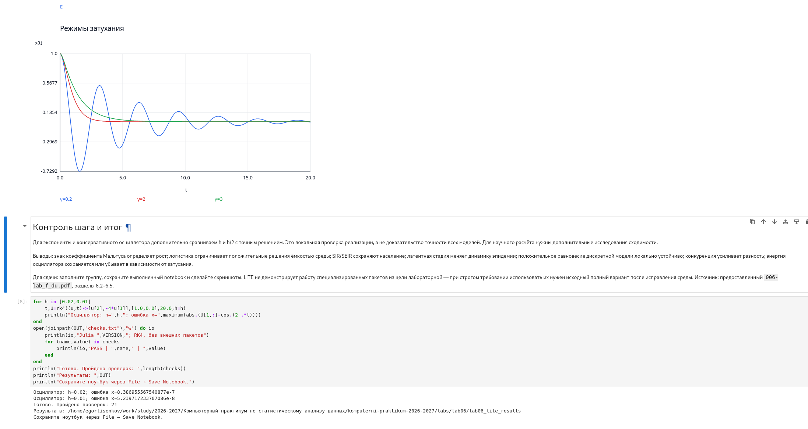{#fig:014 width=100%}

## Вывод
В ходе лабораторной работы освоены методы решения задач в непрерывном и дискретном времени: метод Рунге–Кутты четвёртого верифицирован по аналитическим решениям, первому интегралу и балансу энергии. Проанализированы свойства моделей: режимы Мальтуса, логистическая ёмкость среды, сдвиг пика эпидемии латентной стадией, устойчивость фокуса дискретной модели, конкурентный отбор и затухание осциллятора. Все 21 автоматическая проверка завершены со статусом PASS, результаты сохранены и зафиксированы в системе контроля версий Git.
