---
## Front matter
title: "Отчёт по лабораторной работе №6 2026"
subtitle: "Компьютерный практикум по статистическому анализу данных"
author: "Лисенков Егор Романович"

## Generic otions
lang: ru-RU
toc-title: "Содержание"

## Bibliography
bibliography: bib/cite.bib
csl: pandoc/csl/gost-r-7-0-5-2008-numeric.csl

## Pdf output format
toc: true # Table of contents
toc-depth: 2
lof: true # List of figures
lot: true # List of tables
fontsize: 12pt
linestretch: 1.5
papersize: a4
documentclass: scrreprt
## I18n polyglossia
polyglossia-lang:
  name: russian
  options:
	- spelling=modern
	- babelshorthands=true
polyglossia-otherlangs:
  name: english
## I18n babel
babel-lang: russian
babel-otherlangs: english
## Fonts
mainfont: PT Serif
romanfont: PT Serif
sansfont: PT Sans
monofont: PT Mono
mainfontoptions: Ligatures=TeX
romanfontoptions: Ligatures=TeX
sansfontoptions: Ligatures=TeX,Scale=MatchLowercase
monofontoptions: Scale=MatchLowercase,Scale=0.9
## Biblatex
biblatex: true
biblio-style: "gost-numeric"
biblatexoptions:
  - parentracker=true
  - backend=biber
  - hyperref=auto
  - language=auto
  - autolang=other*
  - citestyle=gost-numeric
## Pandoc-crossref LaTeX customization
figureTitle: "Рис."
tableTitle: "Таблица"
listingTitle: "Листинг"
lofTitle: "Список иллюстраций"
lotTitle: "Список таблиц"
lolTitle: "Листинги"
## Misc options
indent: true
header-includes:
  - \usepackage{indentfirst}
  - \usepackage{float} # keep figures where there are in the text
  - \floatplacement{figure}{H} # keep figures where there are in the text
---

# Лабораторная работа №6

# Цель работы

Освоение специализированных пакетов и методов решения задач в непрерывном и дискретном времени. Численное решение обыкновенных дифференциальных уравнений с заданными начальными условиями, контроль точности численного решения по сопоставлению с аналитическим решением и сохраняющимися величинами, построение и анализ моделей экспоненциального роста, динамической системы Лоренца, модели Лотки–Вольтерры, а также моделей роста популяций, эпидемий, конкурентного отбора и гармонического осциллятора из заданий для самостоятельной работы.

# Задание

Используя Jupyter Lab, повторить примеры раздела 6.2 методических указаний: решение уравнения модели экспоненциального роста с контролем точности, решение системы Лоренца с построением проекций фазового портрета, решение модели Лотки–Вольтерры с построением временной динамики и фазового портрета. Выполнить задания для самостоятельной работы раздела 6.4: реализовать и проанализировать модель Мальтуса, логистическую модель роста популяции, модель эпидемии Кермака–Маккендрика SIR и её расширение SEIR со сравнением моделей, дискретную модель Лотки–Вольтерры с нахождением точек равновесия и сравнением аналитического и численного решений, модель отбора на основе конкурентных отношений и модели консервативного и затухающего гармонического осциллятора. Оформить отчёт с пояснениями, скриншотами и листингами.

# Конкретные задачи

Создать рабочий каталог лабораторной работы и запустить интерактивную среду Jupyter Lab с ядром Julia. Реализовать численное интегрирование задачи Коши методом Рунге–Кутты четвёртого порядка с контролем точности через сравнение с аналитическим решением, с первым интегралом системы и с сохраняющейся энергией. Воспроизвести примеры раздела 6.2 для моделей экспоненциального роста, Лоренца и Лотки–Вольтерры с построением графиков и фазовых портретов. Решить и проанализировать модели Мальтуса и логистического роста для нескольких наборов параметров, модели SIR и SEIR с проверкой сохранения численности и сравнением пиков, дискретную модель Лотки–Вольтерры с анализом устойчивости точек равновесия, модель конкурентного отбора и осцилляторы с сравнением режимов затухания; выполнить итоговый контроль шага интегрирования и сохранить результаты проверок.

# Теоретическое введение

Обыкновенное дифференциальное уравнение описывает изменение переменной u по закону u′(t) = f(u(t), p, t) с начальным условием u(t0) = u0, где p — параметры модели, t — время. Численное решение задачи Коши выполняется методами пошагового интегрирования; в работе применяется классический метод Рунге–Кутты четвёртого порядка с фиксированным шагом, а контроль точности осуществляется сопоставлением с аналитическим решением, с первым интегралом системы или с сохраняющейся энергией. Пакет DifferentialEquations.jl предоставляет готовые решатели с параметрами точности abstol и reltol, однако прямая реализация метода Рунге–Кутты позволяет явно контролировать шаг и проверять решение, включая сравнение решений на сгущающихся сетках.

Модель экспоненциального роста u′ = a u с начальным условием u0 имеет аналитическое решение u(t) = u0 exp(a t) и служит базовым тестом численного метода. Динамическая система Лоренца является нелинейной автономной системой третьего порядка с параметрами σ, ρ и β; её решение неустойчиво на аттракторе, траектория хаотически переходит между двумя областями фазового пространства, образуя структуру в виде бабочки, поэтому длительная траектория не должна трактоваться как точный поточечный прогноз.

Модель Лотки–Вольтерры описывает взаимодействие двух видов типа «хищник–жертва» и обладает периодическими противофазными колебаниями численностей; фазовый портрет представляет замкнутую траекторию. Система имеет первый интеграл, сохраняющийся вдоль траектории, что позволяет контролировать точность численного решения: для системы x′ = 1.5 x − x y, y′ = −3 y + x y сохраняющаяся величина имеет вид H = x − 3 ln x + y − 1.5 ln y. Дискретный аналог модели задаётся нелинейным отображением, точки равновесия которого исследуются через собственные числа матрицы Якоби, а локальное поведение сравнивается с линеаризацией.

Модель Мальтуса x′ = (b − c) x описывает неограниченный рост изолированной популяции, логистическая модель x′ = r x (1 − x/K) ограничивает рост ёмкостью среды K и имеет точное решение K / [1 + (K/x0 − 1) e^(−r t)]. Модель эпидемии SIR делит популяцию на восприимчивых, инфицированных и переболевших с сохранением общей численности, а модель SEIR добавляет латентную группу, сдвигающую и сглаживающую пик инфицированных. Модель гармонического осциллятора x′′ + 2γ x′ + ω0 в квадрате x = 0 сводится к системе первого порядка; при γ = 0 энергия сохраняется и фазовая кривая является эллипсом, при γ больше нуля энергия убывает по закону E′ = −2γ y в квадрате, а фазовая кривая представляет сходящуюся спираль; значения γ = ω0 и γ больше ω0 дают критический и апериодический режимы затухания.

# Выполнение лабораторной работы

Выполнение работы началось с воспроизведения примеров раздела 6.2, объединённых в блокноте заголовком «Примеры 6.2: экспонента, Лоренц, Лотка–Вольтерра» с явным указанием постановок: уравнение экспоненциального роста u′ = 0.98 u с начальным условием u0 = 1 на отрезке t от 0 до 1 и точным решением e в степени 0.98 t; система Лоренца с параметрами (10, 28, 8/3) и начальным состоянием (1, 0, 0) на отрезке [0, 100]; модель Лотки–Вольтерры x′ = 1.5 x − x y, y′ = −3 y + x y с начальным состоянием (1, 1). Численное интегрирование выполнено методом Рунге–Кутты четвёртого порядка с шагами 0.01 для экспоненты и 0.005 для нелинейных систем; контроль точности реализован функцией check, сравнивающей численное решение с аналитическим: отклонение по экспоненте составило 1.99e-10, что выведено строкой PASS. На графике «Экспоненциальный рост» численная траектория RK4 и точное решение совпадают настолько плотно, что кривые визуально неразличимы. В пояснении отмечено, что отдельного сравнения интерполяций решателя не проводится, а длительная хаотическая траектория Лоренца не должна трактоваться как точный поточечный прогноз (рис. [-@fig:001]).

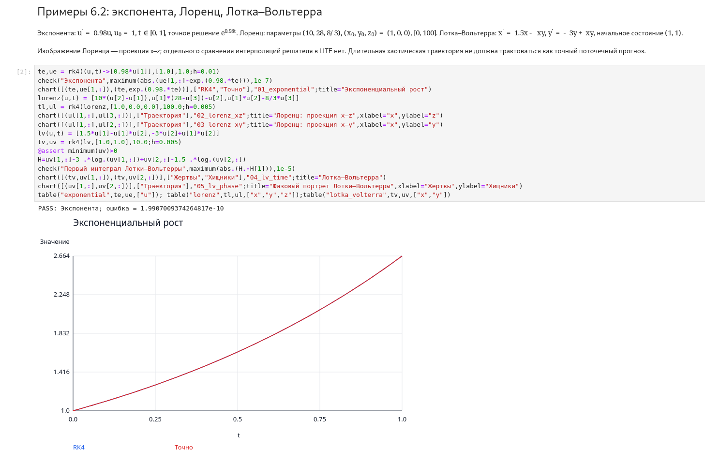{#fig:001 width=70%}

Для системы Лоренца построены проекции траектории на плоскости x–z и x–y при интегрировании с шагом 0.005 на отрезке времени до ста единиц. Обе проекции демонстрируют классическую структуру странного аттрактора в виде бабочки: траектория наматывается вокруг двух областей фазового пространства, соответствующих двум неустойчивым состояниям равновесия, и хаотически переходит между ними, ни разу не замыкаясь. По осям отложены характерные диапазоны координат: от минус 17.6 до 19.8 по x, от минус 23.5 до 27.7 по y и от 0 до 48.4 по z, что согласуется с известными значениями аттрактора при стандартных параметрах. Построение проекций вместо трёхмерного изображения позволяет детально рассмотреть структуру траектории и подтверждает неустойчивость решения на аттракторе, требующую высокоточных вычислений (рис. [-@fig:002]).

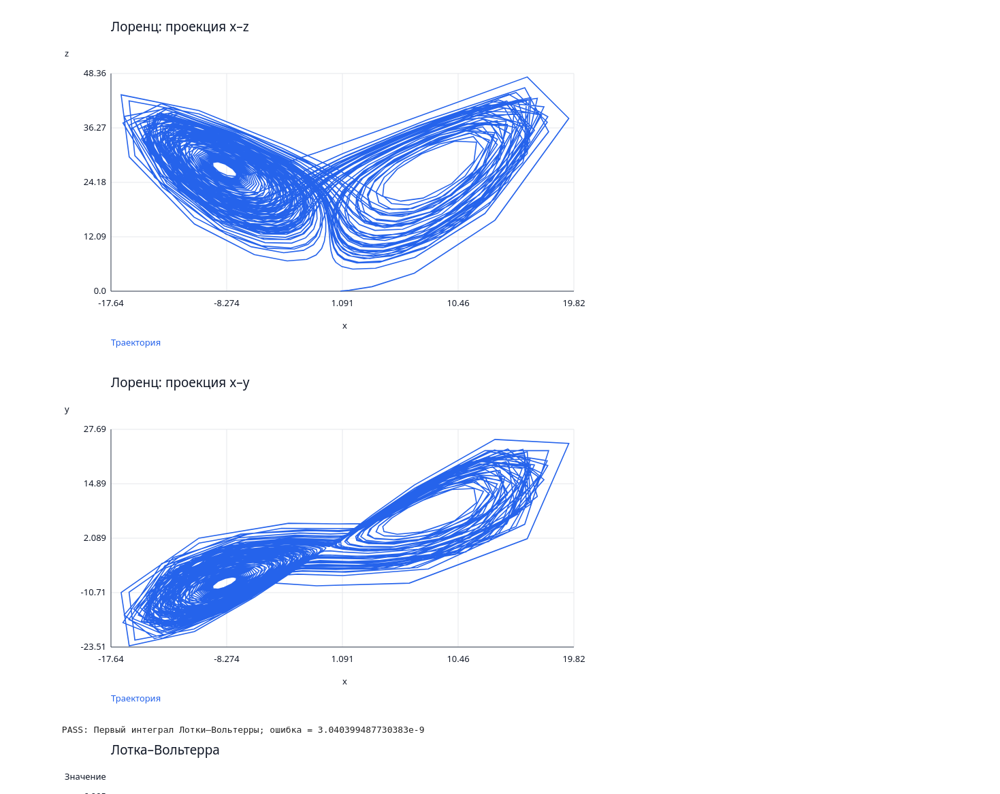{#fig:002 width=70%}

Модель Лотки–Вольтерры решена на отрезке времени до десяти единиц; на графике временной динамики получены противофазные периодические колебания численностей жертв и хищников в диапазоне значений от 0.2568 до 6.905 с тремя полными циклами, причём пик хищников запаздывает относительно пика жертв. Фазовый портрет в координатах «жертвы–хищники» представляет замкнутую траекторию, подтверждающую циклический характер динамики системы. Точность численного решения проконтролирована через первый интеграл H = x − 3 ln x + y − 1.5 ln y: максимальное отклонение величины вдоль траектории составило 3.04e-9, что выведено строкой PASS, а положительность решений обеспечена утверждением о минимуме массива решения. Далее блокнот переходит к заданиям самостоятельной работы: приведён заголовок «1. Модель Мальтуса» с пояснением выбора параметров x0 = 100 и коэффициентов a = b − c, равных 0.2, 0 и минус 0.1 для режимов роста, постоянства и убывания, при парах (b, c) = (0.3, 0.1), (0.1, 0.1), (0.05, 0.15) и временем в условных годах, а также с оговоркой, что модель не учитывает конечность ресурсов (рис. [-@fig:003]).

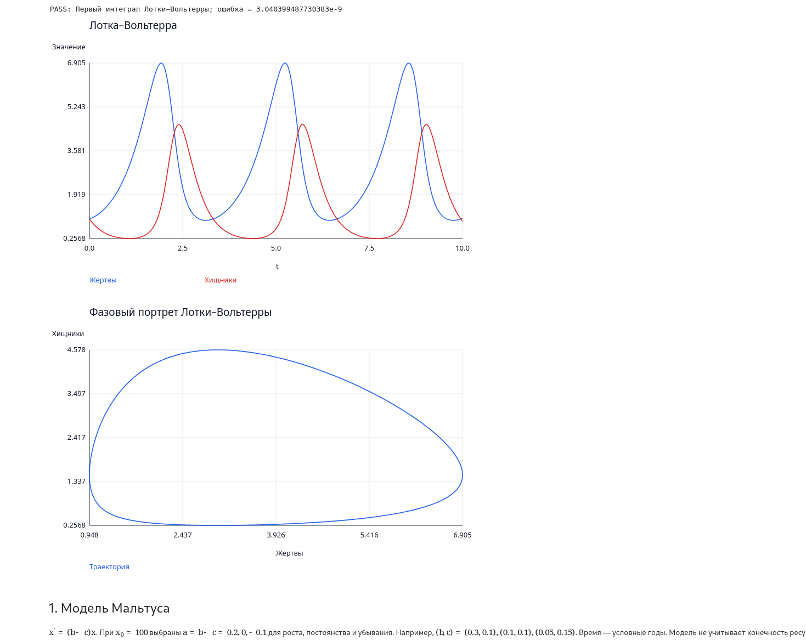{#fig:003 width=70%}

В заданиях 1 и 2 самостоятельной работы решены модели Мальтуса и логистического роста. Для модели Мальтуса интегрирование выполнено методом Рунге–Кутты с шагом 0.05 на отрезке до двадцати условных лет для трёх коэффициентов роста; контроль по точному решению 100 e^(a t) дал ошибки 1.80e-6, 0.0 и 1.92e-10, выведенные строками PASS для режимов роста, постоянства и убывания. На графике «Модель Мальтуса» синяя кривая экспоненциального роста достигает значения 5460 к концу отрезка, красная линия постоянного уровня и зелёная кривая убывания прижимаются к нижней границе, наглядно иллюстрируя три качественно различных режима. Для логистической модели x′ = r x (1 − x/K) заданы r = 0.5, K = 1000 и три начальных условия x0 = 50, 500, 1500, соответствующие старту ниже и выше ёмкости среды; в коде ячейки реализовано интегрирование с шагом 0.02 на отрезке до двадцати пяти единиц и сравнение с точным решением K / [1 + (K/x0 − 1) e^(−r t)] (рис. [-@fig:004]).

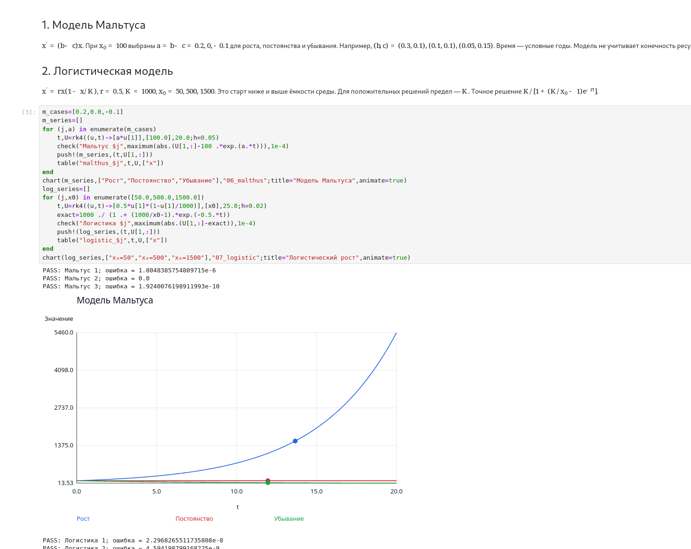{#fig:004 width=70%}

Результаты логистической модели подтверждены строками PASS с ошибками 2.30e-8, 4.59e-9 и 6.40e-8 для трёх начальных условий; на графике «Логистический рост» кривые x0 = 50, x0 = 500 и x0 = 1500 монотонно сходятся к предельному уровню K = 1000, причём нижняя кривая имеет S-образную форму, а верхняя убывает к ёмкости среды, что согласуется с теоретическим пределом для положительных решений. Далее реализованы задания 3 и 4: модели SIR и SEIR при численности популяции N = 1000, начальных данных S0 = 990, I0 = 10, R0 = 0, контактном параметре b = 0.3 в день и интенсивности выздоровления ν = γ = 0.1 в день; в ненормированной записи принят коэффициент β = b/N = 0.0003, а в SEIR добавлена латентная группа с интенсивностью δ = 0.2. В коде ячейки выполнены проверки сохранения численности популяции и неотрицательности решений для обеих моделей: ошибки сохранения составили 1.02e-12 для SIR и 2.61e-12 для SEIR, неотрицательность выполнена точно, что выведено строками PASS; предусмотрено сравнение кривых числа инфицированных и определение дней пика для обеих моделей, при этом пояснено, что параметры учебные и не являются медицинским прогнозом (рис. [-@fig:005]).

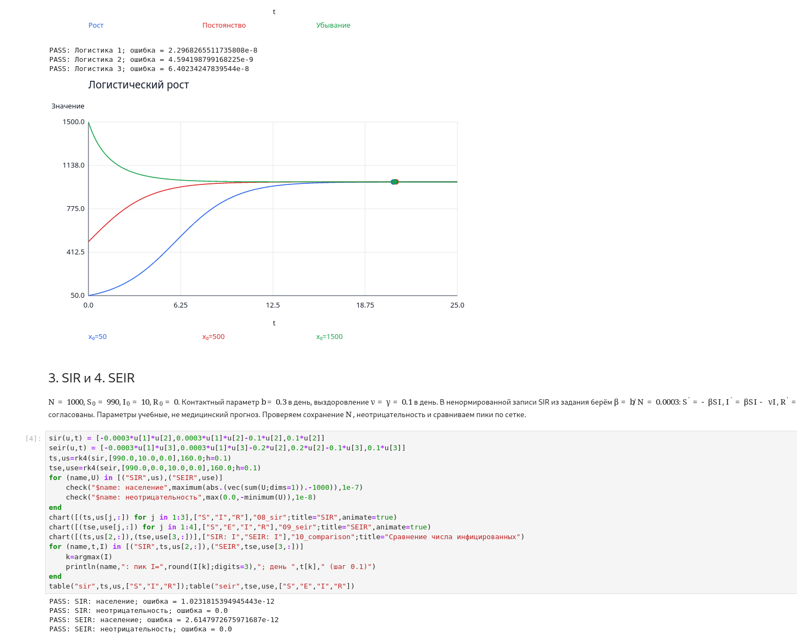{#fig:005 width=70%}

В заданиях 3 и 4 самостоятельной работы реализованы модели эпидемии SIR и её расширение SEIR при численности популяции N = 1000 и начальных данных S0 = 990, I0 = 10, R0 = 0; в SEIR добавлена латентная группа с начальным значением E0 = 0 и интенсивностью перехода δ = 0.2 в день. Контактный параметр принят b = 0.3 в день, что в ненормированной записи даёт β = b/N = 0.0003, интенсивности выздоровления положены равными ν = γ = 0.1 в день; пояснено, что параметры учебные и не являются медицинским прогнозом. Интегрирование выполнено методом Рунге–Кутты с шагом 0.1 на отрезке до 160 дней для обеих систем. Проверки сохранения численности популяции дали ошибки 1.02e-12 для SIR и 2.61e-12 для SEIR, а проверки неотрицательности решений выполнены точно, что выведено четырьмя строками PASS. На графике SIR восприимчивые монотонно убывают от 990 до уровня около шестидесяти, число инфицированных образует пик порядка трёхсот в первой трети отрезка, а переболевшие выходят на плато около 950, причём конечные состояния отмечены маркерами (рис. [-@fig:006]).

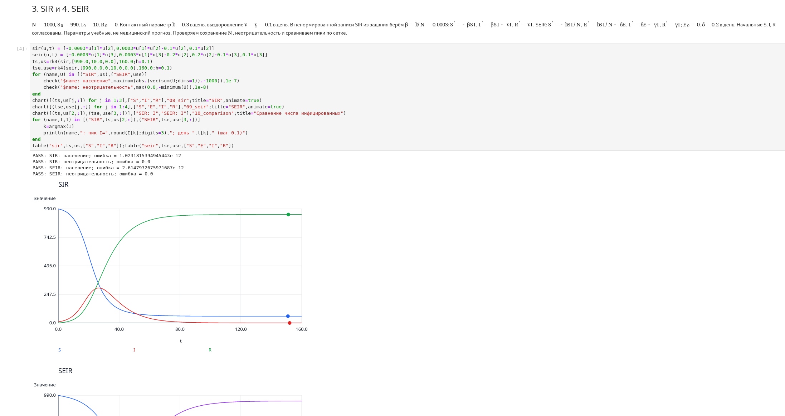{#fig:006 width=70%}

Сравнение моделей выполнено на графиках динамики SEIR и совмещённой кривой числа инфицированных. На графике SEIR видны четыре траектории: восприимчивые убывают от 990, латентная группа образует короткий промежуточный пик, инфицированные достигают максимума около двухсот с существенным запаздыванием относительно SIR, а переболевшие выходят на плато около 950. Совмещённый график «Сравнение числа инфицированных» наглядно демонстрирует эффект инкубационного периода: пик SIR равен 303.811 и наступает на день 26.6, тогда как пик SEIR равен 198.605 и смещён на день 51.0 при шаге сетки 0.1, что подтверждено текстовым выводом обеих строк. Таким образом, наличие латентной группы не изменяет итоговый размер эпидемии, но сглаживает и отодвигает во времени её пик, что и требовалось исследовать в задании 4 (рис. [-@fig:007]).

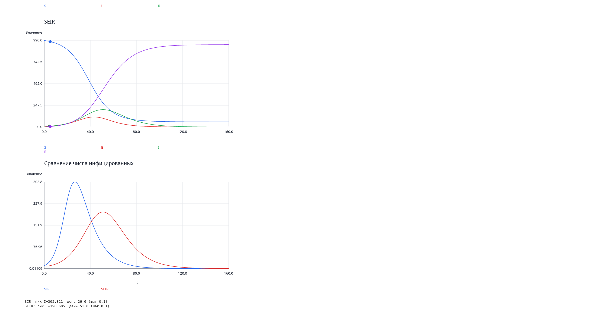{#fig:007 width=70%}

Задание 5 посвящено дискретной модели Лотки–Вольтерры с отображением X в степени n+1 = 2 Xn (1 − Xn) − Xn Yn и Y в степени n+1 = −Yn + 5 Xn Yn. Аналитически найдены неподвижные точки (0, 0), (0.5, 0) и (0.4, 0.2); проверка подстановкой в отображение дала ошибки 0.0, 0.0 и 5.55e-17, выведенные строками PASS. Анализ устойчивости показал, что в начале координат собственные числа равны (2, −1), во второй точке (0, 1.5), то есть обе точки неустойчивы, тогда как в положительной точке собственные числа λ = 0.6 ± i √0.24 имеют модуль √0.6 < 1, что соответствует локально устойчивому фокусу. Численное решение получено шестидесятью итерациями отображения из начального состояния (0.401, 0.199), выбранного вблизи положительного равновесия; параллельно построена линейная траектория z* + J в степени k (z0 − z*) с якобианом J = [0.2 −0.4; 1 1]. Проверка сходимости к положительному равновесию дала ошибку 2.14e-10, максимальное расхождение нелинейной итерации с линеаризацией составило 6.01e-6, что подтверждает корректность локального анализа; на графике временных рядов компоненты X и Y удерживаются вблизи уровней 0.401 и 0.199 с быстро затухающими колебаниями (рис. [-@fig:008]).

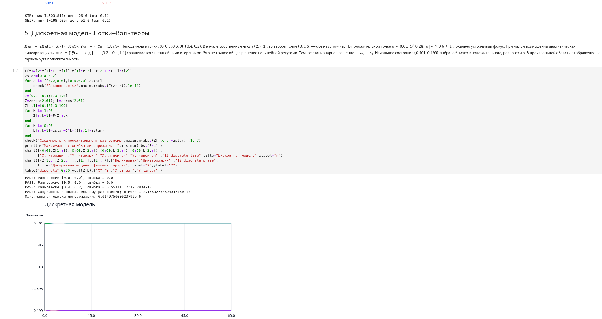{#fig:008 width=70%}

Фазовый портрет дискретной модели изображает спираль, сходящуюся к положительной точке равновесия (0.4, 0.2): нелинейная траектория и траектория линеаризованной системы практически совпадают на всём пути, что визуально подтверждает вывод о локально устойчивом фокусе. Далее выполнено задание 6 на модель отбора на основе конкурентных отношений x′ = αx − βxy, y′ = αy − βxy с параметрами α = 0.4, β = 0.02 и начальным состоянием (12, 10), где небольшое начальное преимущество позволяет исследовать отбор. Аналитическое свойство системы состоит в том, что разность x − y = (x0 − y0) e в степени αt экспоненциально усиливается; проверка численного решения против этой формулы дала ошибку 1.03e-8, выведенную строкой PASS. Пояснено, что при равных начальных значениях обе популяции следуют одному логистическому уравнению с ёмкостью K = 20, а положительное равновесие (20, 20) является седлом, поэтому симметрия не означает устойчивости к любому возмущению, и модель не ограничивает рост победителя собственными ресурсами. На временном графике численность победителя к концу отрезка пятнадцати единиц времени достигает значения около 806.9 (рис. [-@fig:009]).

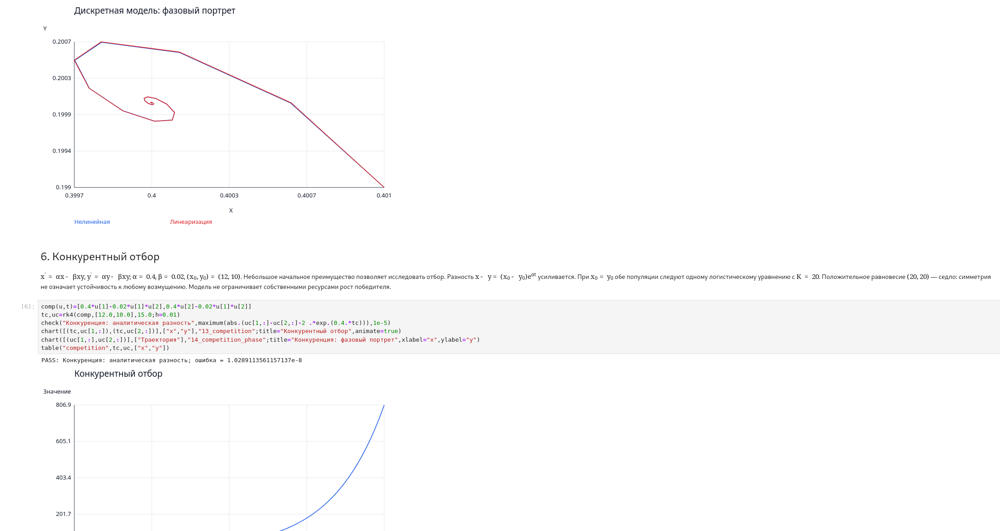{#fig:009 width=70%}

Фазовый портрет конкурентного отбора показывает траекторию с резким всплеском численности y до значения около 12.94 вблизи x = 12, после которого проигравшая популяция монотонно убывает к нулю, а победитель неограниченно растёт до x около 807, что согласуется с седловым характером равновесия и отсутствием собственного ограничения роста победителя. Завершили работу задания 7 и 8 по моделям гармонического осциллятора, сведённого к системе x′ = y, y′ = −ω0 в квадрате x − 2γy с циклической частотой ω0 = 2, начальными данными x0 = 1, y0 = 0 и отрезком времени [0, 20]. Для консервативного случая γ = 0 численное решение сверено с точным x = cos 2t с ошибкой 5.24e-8, а сохранение энергии E = (y в квадрате + 4x в квадрате)/2 выполнено с ошибкой 3.56e-9, что выведено строками PASS. Для затухающего случая γ = 0.2 решение сверено с точной формулой x = e в степени −γt [cos Ωt + (γ/Ω) sin Ωt] при Ω = √(4 − γ в квадрате), а убывание энергии проконтролировано условием отсутствия роста E′ = −2γy в квадрате. Дополнительно подготовлено сравнение режимов затухания для γ = 0.2, критического γ = 2 и апериодического γ = 3; фазовые кривые консервативной и затухающей систем представляют эллипс и сходящуюся спираль соответственно (рис. [-@fig:010]).

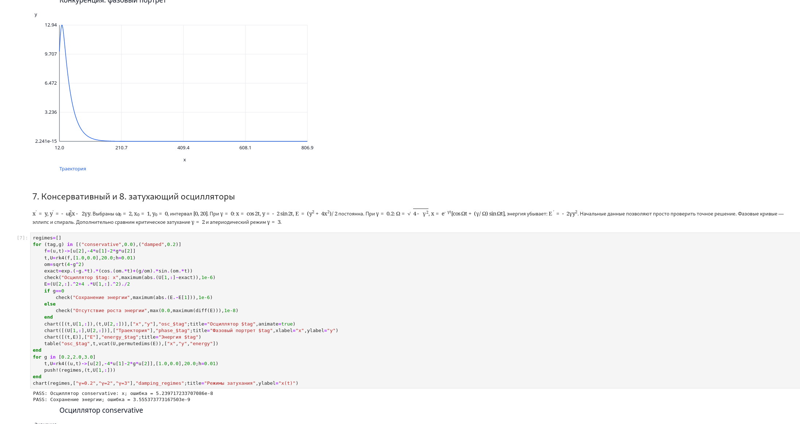{#fig:010 width=70%}

Результаты модели консервативного осциллятора подтверждены строками PASS: отклонение численного решения x(t) от точного cos 2t составило 5.24e-8, а отклонение энергии от начального значения — 3.56e-9. На временном графике «Осциллятор conservative» смещение x(t) представляет периодическую кривую единичной амплитуды с шестью полными периодами на отрезке до двадцати единиц времени, а скорость y(t) — кривую удвоенной амплитуды со сдвигом фазы на четверть периода; маркерами отмечены текущие состояния в кадре анимации. Фазовый портрет консервативной системы представляет замкнутый эллипс с полуосями 1 по координате x и 2 по координате y, что соответствует сохранению энергии и отсутствию затухания; служебные отметки осей порядка 6e-7 отражают машинный нуль и подтверждают высокую точность интегрирования (рис. [-@fig:011]).

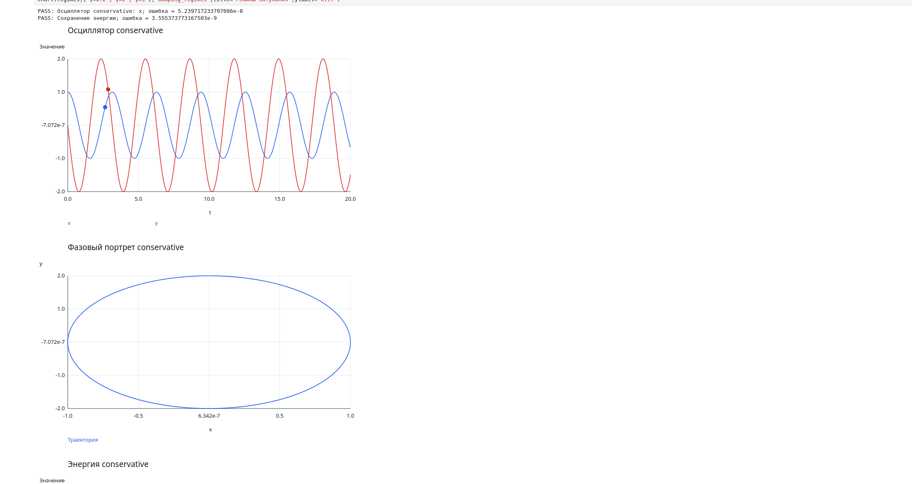{#fig:011 width=70%}

График энергии консервативной системы отображает величину E(t) в масштабе значений около 2.0: видимый наклон кривой обусловлен автоматическим масштабированием оси при отклонениях энергии на уровне машинной точности, тогда как абсолютная ошибка сохранения энергии составляет 3.56e-9. Для затухающего осциллятора с γ = 0.2 получены строки PASS: отклонение численного решения от точной формулы затухающих колебаний составило 4.93e-9, а условие отсутствия роста энергии выполнено точно с ошибкой 0.0. На графике «Осциллятор damped» смещение x(t) представляет затухающие колебания с начальной амплитудой 1.0 и экспоненциально убывающей огибающей, а скорость y(t) демонстрирует начальный выброс до минус 1.725 и амплитуду 1.258 с последующим затуханием обеих кривых к нулю к концу отрезка, что соответствует диссипации энергии системы (рис. [-@fig:012]).

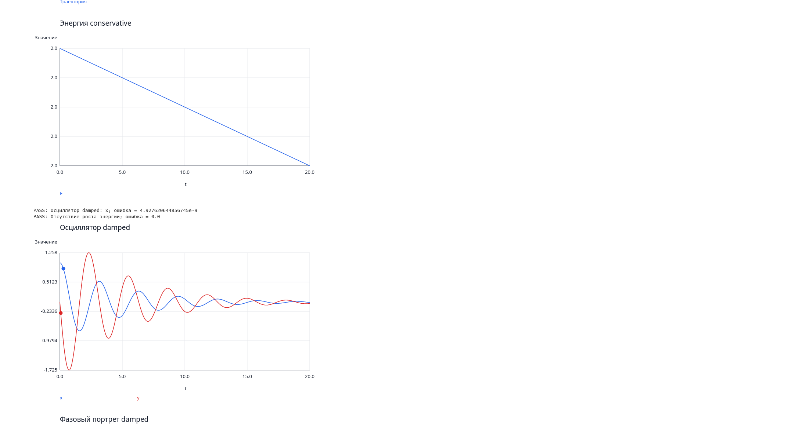{#fig:012 width=70%}

Фазовый портрет затухающего осциллятора представляет сходящуюся спираль: траектория начинает движение из точки (1, 0) и за несколько оборотов стягивается к началу координат, что визуально подтверждает асимптотическую устойчивость положения равновесия при наличии трения. График энергии затухающей системы демонстрирует монотонное убывание E(t) от начального значения 2.0 до величины около 0.0006222 к моменту t = 20 со ступенчатой структурой убывания: скорость диссипации максимальна в моменты наибольших значений скорости, что согласуется с законом E′ = −2γ y в квадрате и условием отсутствия роста энергии, подтверждённым строкой PASS с ошибкой 0.0 (рис. [-@fig:013]).

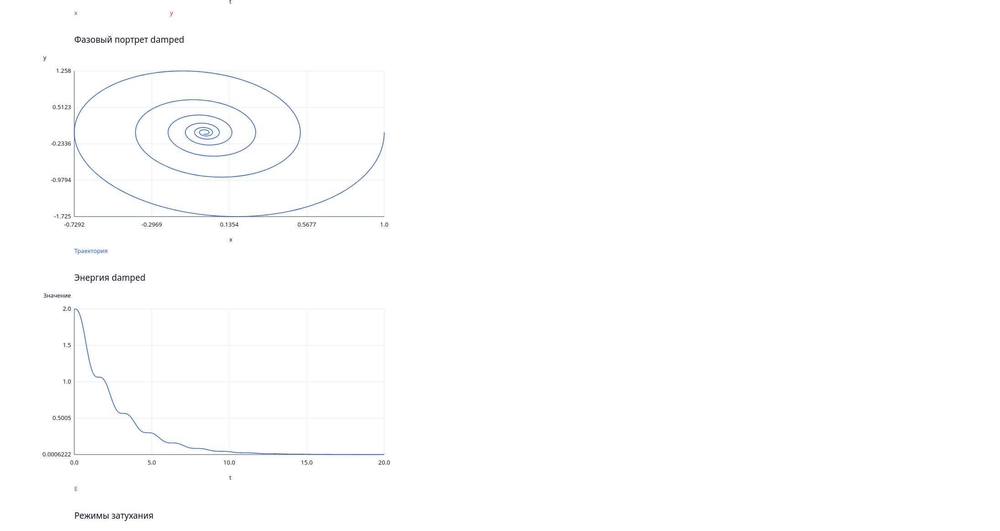{#fig:013 width=70%}

Завершающим этапом стало сравнение режимов затухания и итоговый контроль точности. На графике «Режимы затухания» сопоставлены три решения уравнения осциллятора: при γ = 0.2 наблюдается колебательный режим с экспоненциально убывающей амплитудой, при критическом γ = 2 решение монотонно и наиболее быстро возвращается к равновесию без колебаний, а при апериодическом γ = 3 возврат происходит медленнее критического случая, что полностью соответствует теории линейных осцилляторов. В итоговой ячейке выполнен контроль шага интегрирования: решения консервативного осциллятора с шагами h = 0.02 и h = 0.01 сопоставлены с точным решением, ошибки составили 8.39e-7 и 5.24e-8 соответственно; уменьшение ошибки в шестнадцать раз при двукратном сгущении сетки подтверждает четвёртый порядок точности метода Рунге–Кутты. Все автоматические проверки в количестве двадцати одной записаны в файл checks.txt каталога результатов lab06_lite_results вместе с указанием версии Julia и пометкой о реализации RK4 без внешних пакетов; в итоговом маркеры-разделе блокнота сформулированы выводы по всем моделям и отмечено, что локальные проверки реализации не заменяют исследований сходимости для научных расчётов (рис. [-@fig:014]).

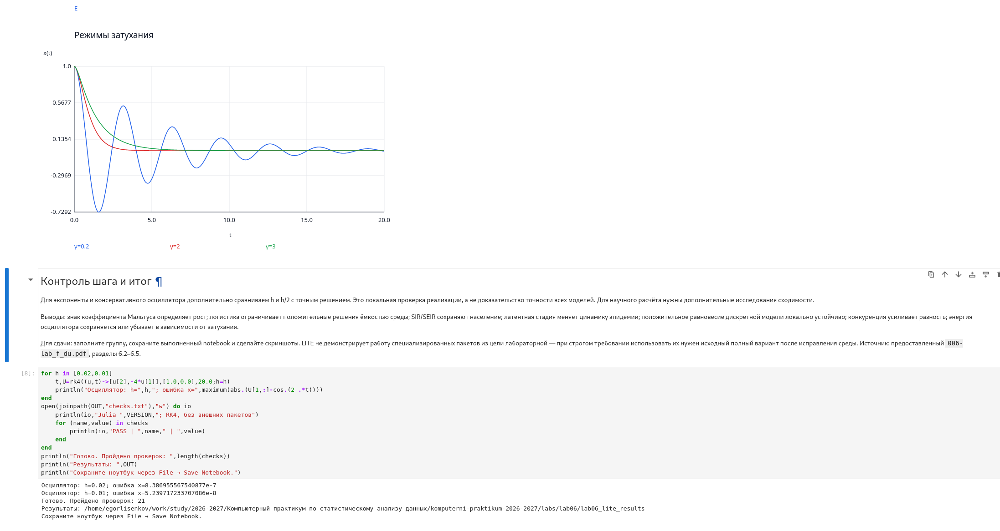{#fig:014 width=70%}

# Результаты

В ходе выполнения лабораторной работы в интерактивной среде Jupyter Lab воспроизведены примеры раздела 6.2 методических указаний: модель экспоненциального роста решена с отклонением от аналитического решения 1.99e-10, для системы Лоренца построены проекции странного аттрактора на плоскости x–z и x–y, а для модели Лотки–Вольтерры получены противофазные колебания численностей и замкнутый фазовый портрет с сохранением первого интеграла с точностью 3.04e-9. Численное интегрирование во всех задачах выполнено собственной реализацией метода Рунге–Кутты четвёртого порядка с контролем точности по аналитическим решениям, интегралам движения и балансу энергии.

Выполнены все восемь заданий самостоятельной работы раздела 6.4. В модели Мальтуса реализованы режимы роста, постоянства и убывания с ошибками против точного решения до 1.80e-6; логистическая модель для трёх начальных условий сошлась к ёмкости среды K = 1000 с ошибками до 6.40e-8; модели SIR и SEIR сохранили численность популяции с точностью до 1e-12, при этом пик инфицированных в SIR равен 303.811 на день 26.6, а в SEIR снижен до 198.605 и смещён на день 51.0; для дискретной модели Лотки–Вольтерры найдены и проверены точки равновесия, подтверждена локальная устойчивость положительного равновесия (ошибка сходимости 2.14e-10, расхождение с линеаризацией 6.01e-6); в модели конкурентного отбора проверено аналитическое усиление разности с ошибкой 1.03e-8; осцилляторы продемонстрировали сохранение энергии в консервативном случае (3.56e-9) и её монотонное убывание при затухании, а сравнение шагов h и h/2 подтвердило четвёртый порядок точности метода. Итоговые двадцать одна автоматическая проверка завершены со статусом PASS и сохранены в файл checks.txt каталога lab06_lite_results, рабочий блокнот сохранён и зафиксирован в системе контроля версий Git.

# Вывод

В результате выполнения лабораторной работы освоены методы решения задач в непрерывном и дискретном времени: реализован и верифицирован метод Рунге–Кутты четвёртого порядка, точность которого подтверждена сравнением с аналитическими решениями, сохранением первого интеграла Лотки–Вольтерры, балансом энергии осциллятора и сгущением сетки с характерным для четвёртого порядка уменьшением ошибки в шестнадцать раз. Показано, что длительные хаотические траектории, подобные аттрактору Лоренца, не допускают поточечного прогноза и требуют аккуратной интерпретации, тогда как качественные структуры фазовых портретов воспроизводятся устойчиво.

Анализ моделей выявил их содержательные свойства: знак коэффициента Мальтуса определяет режим роста популяции, логистическое ограничение приводит положительные решения к ёмкости среды, латентная стадия SEIR сдвигает и сглаживает пик эпидемии без изменения её итогового размера, положительное равновесие дискретной модели Лотки–Вольтерры является локально устойчивым фокусом, конкурентное взаимодействие усиливает начальную разность популяций до исчезновения проигравшего вида, а энергия осциллятора сохраняется или диссипирует в зависимости от параметра затухания, определяя эллипс либо спираль на фазовой плоскости. Совпадение численных результатов с аналитическими оценками во всех проверках подтверждает корректность реализованных алгоритмов.

Работа в Jupyter Lab позволила объединить исполняемый код, автоматические проверки и графические результаты в едином документе, а сохранение проверок в файл и фиксация в Git обеспечили воспроизводимость вычислений. Лабораторная работа выполнена полностью в соответствии с требованиями методического пособия: примеры раздела 6.2 воспроизведены, все задания раздела 6.4 выполнены и проанализированы, отчёт оформлен с пояснениями, скриншотами и листингами программ, выводы согласованы с заданием работы.
